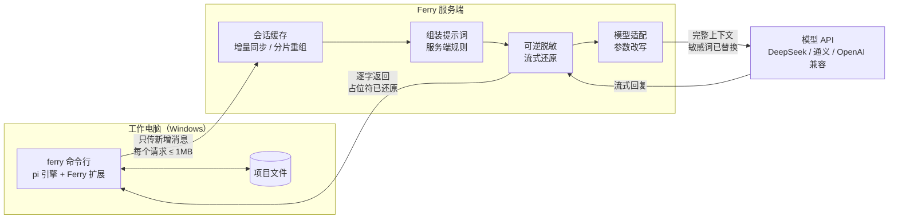

# Ferry · 面向受限网络的编码 Agent

Ferry 是一个"客户端 + 服务端"结构的编码 agent，分工对标 Cursor：

- **客户端**（工作电脑上的命令行工具）负责读写文件、执行命令、保存对话记录；
- **服务端**（云服务器或另一台电脑）负责组装最终提示词、管理上下文、脱敏、调用模型。

它解决的场景是：公司电脑对外的单个请求不能超过 1MB，敏感信息不能发给外部模型，模型的 API Key 也不应放在员工电脑上。



## 关键设计

| 问题 | 做法 | 代码位置 |
|---|---|---|
| 单个请求 ≤ 1MB，但长会话的上下文会超过 1MB | 客户端每轮只上传新增消息，用哈希链校验双方一致；超过 512KB 的内容拆块上传；服务端拼回完整上下文再发给模型 | `client/lib/sync.mjs`、`server/ferry_server/store.py` |
| 服务端缓存丢了怎么办 | 客户端始终保存完整记录；服务端只是缓存。校验不一致时返回 409，客户端自动全量重传 | 同上 |
| 提示词由谁决定 | 和 Cursor 一样由服务端完成最终组装：通用规则 + 按项目的规则，改完下一轮即生效，不用动客户端 | `server/ferry_server/prompt.py` |
| 敏感信息不外发 | 词表和正则命中的内容替换成确定性占位符 `[FERRY-XXXXXXXX]`（HMAC），同一个值始终对应同一个占位符，模型看到的对话前后一致 | `server/ferry_server/redact.py` |
| 模型回复里的占位符 | 正文逐字转发，只暂扣可能是占位符开头的最多 15 个字符；工具调用参数在该轮结束时一次性还原后发出，客户端永远拿到真实路径和命令 | `server/ferry_server/stream.py` |
| 多家模型 | 统一走 OpenAI 兼容接口：DeepSeek、OpenAI、Claude（Anthropic 的兼容接口）；每个模型可配置去掉或改名的参数（如 `max_completion_tokens` → `max_tokens`），`ferry doctor` 会真的给每个模型发一个小请求 | `server/ferry_server/config.py`、`prompt.py` |
| 本地安全底线 | 禁止目录、执行前确认都在客户端执行，服务端无法绕过；拦截原因里不含受保护的名字 | `client/lib/guard.mjs` |
| 可审计 | 访问日志和审计日志只记大小、模型、脱敏计数、用量，不记对话内容 | `server/ferry_server/app.py` |
| 上下文太长 | 两层压缩：pi 在接近模型窗口时把旧历史写成摘要；服务端在发给模型前封顶（默认 900KB），从最旧的工具输出开始删 | `server/ferry_server/prompt.py` |
| 公司代理 | 客户端所有请求统一走代理（环境变量或配置项），支持 NO_PROXY | `client/lib/config.mjs` |
| 好装、好更新 | 离线安装包 + `ferry install`；`ferry update` 从 GitHub 发布页取最新版；没登录远程服务端时自动在本机启动服务端 | `client/lib/setup.mjs` |
| 不重复造轮子 | Agent 循环、工具和终端界面直接用开源的 [pi](https://github.com/earendil-works/pi)（MIT），通过它公开的 `main()` 和扩展接口嵌入，不 fork 内核 | `client/bin/ferry.mjs` |

更细的协议和取舍见 [docs/DESIGN.md](docs/DESIGN.md)。

## 和 Cursor 的对应关系

| | Cursor | Ferry |
|---|---|---|
| 对话记录 | 存在客户端，每次请求带上 | 存在客户端；服务端额外缓存一份，所以每次只需传新增部分 |
| 工具执行（读写文件、命令） | 客户端 | 客户端 |
| 最终提示词组装 | 服务端（官方文档说明即使用自己的 API Key 也经服务端） | 服务端 |
| 模型调用和 API Key | 服务端 | 服务端 |
| 代码库语义检索 | 服务端索引 | 路线图中 |

## 快速开始

### Windows（工作电脑）

从 [Releases](https://github.com/wvans123/ferry/releases/latest) 下载 `ferry-windows-x.y.z.zip`，解压后在 cmd 里：

```bat
cd /d 解压出的文件夹
node client\bin\ferry.mjs install
```

重新打开 cmd，之后的用法和 Cursor CLI 一样：

```bat
cd /d 你的项目文件夹
ferry                       :: 进入对话界面
ferry -p "这个项目是做什么的"   :: 只问一句
ferry doctor                :: 逐项检查环境
ferry update                :: 更新到 GitHub 上的最新版
```

不需要 venv、Docker、npm 或 PyPI：安装包带齐了全部依赖，服务端直接装进现有的 Python。没有 `ferry login` 时，`ferry` 会在后台自己启动一个本机服务端，从环境变量读取 Key（`ANTHROPIC_API_KEY`、`OPENAI_API_KEY`、`DEEPSEEK_API_KEY`，设了哪个就有哪个模型），退出时一起关掉。逐步说明和排错见 [INSTALL-WINDOWS.md](INSTALL-WINDOWS.md)。

### 服务端放在另一台机器上

```bash
pip install ./server                   # 或安装包里的 wheels：pip install --no-index --find-links wheels ferry-server
export ANTHROPIC_API_KEY=...           # 和/或 OPENAI_API_KEY、DEEPSEEK_API_KEY
ferry-server                           # 零配置：单用户，令牌在 ~/.ferry-server/token
# 多用户、多模型：复制 server/ferry-server.example.toml 为 ferry-server.toml 再启动
```

用 `deploy/Caddyfile` 加 HTTPS、`deploy/ferry-server.service` 托管进程。工作电脑上执行一次：

```bat
ferry login https://你的服务器地址 令牌
```

之后 Key 和对话缓存都在服务器上，工作电脑上的用法不变；`ferry logout` 回到本机模式。公司代理：设置 `HTTPS_PROXY` 环境变量，或在 `%USERPROFILE%\.ferry\config.json` 里加 `"proxy": "http://代理地址:端口"`。

### 开发

```bash
git clone https://github.com/wvans123/ferry && cd ferry
npm ci
pip install -e server pytest
pytest server/tests            # 单元测试
python selftest/run.py         # 端到端：假模型 + 服务端 + 客户端 + 假代理，跑完 GOAL.md 里的 25 项检查
node client/bin/ferry.mjs      # 直接从源码运行
```

端到端测试不需要真实模型和 API Key。每次提交，GitHub Actions 在 Linux 和 Windows 上各跑一遍；main 分支上 `package.json` 的版本号变了，测试通过后自动构建 Windows 安装包并发布。

## 目录

```
client/     ferry 命令行（Node.js）：bin/ferry.mjs 入口，lib/ 下是同步、安全规则、界面扩展、安装和更新
server/     ferry-server（Python / FastAPI）：会话缓存、提示词组装、脱敏、流式还原、模型适配
selftest/   端到端自测：假模型、假代理、run.py
deploy/     云服务器部署：systemd 服务、Caddy HTTPS
scripts/    构建 Windows 离线安装包
.github/    CI（Linux + Windows）和发布流程
docs/       设计说明
```

## 离商业级还差什么

v0.5 是一个可以自用、可以演示的原型：核心链路有 20 个单元测试和 25 项端到端测试覆盖。离商业产品还差下面这些：

| 方面 | 现状 | 还缺 |
|---|---|---|
| 核心功能 | 增量同步、服务端组装提示词、可逆脱敏、流式还原、模型适配、两层压缩 | Claude 原生接口（提示词缓存能显著降低多轮费用）、服务端摘要、代码库检索 |
| 可靠性 | 缓存丢失自动恢复（含调用模型前一刻）、版本协商 | 多实例部署（目前单机 SQLite）、数据备份 |
| 安全 | 多用户隔离、恒定时间令牌比较、拒绝弱密钥、HTTPS 警告、日志不含正文 | 限流、令牌过期与轮换、客户端令牌存进系统凭据库（现在是配置文件明文） |
| 脱敏 | 词表 + 正则，覆盖正文、工具参数、流式输出 | 自动识别人名和机构名（NER），图片内容 |
| 真实环境 | 在 Linux 上用假模型、假代理验证 | Windows、真实 DeepSeek、真实公司代理 |
| 交付 | 离线安装包、一条命令安装和更新、CI 覆盖 Windows | 代码签名、安装向导（.msi） |
| 运营 | 访问日志、审计日志 | 管理界面（用户、用量、费用）、监控告警 |

## 限制

- 只有词表和正则里的内容会被替换；没有列入的信息仍会发给模型。脱敏是降低风险，不是保证。
- 服务端会缓存完整会话原文，所以服务端本身必须可信，并只通过 HTTPS 访问。
- CI 在 GitHub 的 Windows 机器上跑同一套自测，但还没在真实的公司电脑、真实 DeepSeek 和公司代理下验证过。

## 致谢

[pi](https://github.com/earendil-works/pi)（MIT）· [FastAPI](https://fastapi.tiangolo.com/) · [HTTPX](https://www.python-httpx.org/) · [undici](https://github.com/nodejs/undici)
