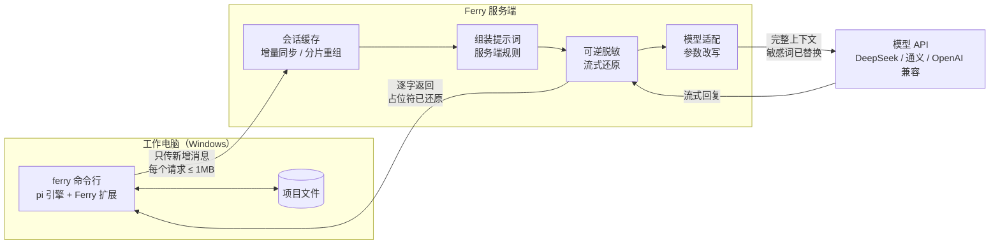

# Ferry

**在受限的公司电脑上用的编码 agent，像 Cursor CLI 一样在 cmd 里对话。**
A Cursor-style coding agent for locked-down Windows PCs: the CLI does the work locally, a server you control builds the prompt, redacts secrets and picks the model, and every request stays under 1 MB.

[](https://github.com/wvans123/ferry/actions/workflows/ci.yml)

适合这样的环境：

- 公司电脑对外的**单个请求不能超过 1MB**；
- **敏感信息**（项目代号、内网地址、邮箱）不应原样发给外部模型；
- 模型的 **API Key 不想放在公司电脑上**，用哪个模型想由自己的服务器决定。

```
C:\my-project> ferry

  Ferry v0.6.0  server on this computer
  Files and history stay on this machine. The server builds the prompt and calls the model.

> 读一下 notes.txt，然后新建 summary.md 总结它
  （agent 读文件；要写文件时先弹出 Allow / Deny 让你确认）
  已新建 summary.md。
                                                                            (ferry) auto
```

## 在 Windows 上三步用起来

需要 Node.js 22+ 和 Python 3.11–3.14（只用来跑本机服务端；只连远程服务端时可以不装）。所有命令在 **cmd** 里执行。

**1. 下载** [Releases](https://github.com/wvans123/ferry/releases/latest) 里的 `ferry-windows-x.y.z.zip`，右键"全部解压"。

**2. 安装**（离线，不需要 venv、npm、PyPI）：

```bat
cd /d %USERPROFILE%\Downloads\ferry-x.y.z
node client\bin\ferry.mjs install
```

**3. 设置 Key，重新打开 cmd，开始用：**

```bat
setx DEEPSEEK_API_KEY sk-你的key
```

```bat
ferry doctor
cd /d C:\你的项目
ferry
```

`ferry doctor` 全是 OK 就说明 Key、网络、模型都没问题。逐步截图式说明和排错见 [INSTALL-WINDOWS.md](INSTALL-WINDOWS.md)。

### 常用命令

| 命令 | 作用 |
|---|---|
| `ferry` | 在当前文件夹开始对话（快速按两次 Ctrl+C 退出） |
| `ferry -p "问题"` | 只问一句，打印回答后退出 |
| `ferry doctor` | 逐项检查，最后给模型发一个小请求确认能用 |
| `ferry update` | 更新到 GitHub 上的最新版（访问不了 GitHub 时：`ferry update 下载好的.zip`） |
| `ferry login 服务器地址 令牌` | 改用另一台机器上的服务端 |
| `ferry logout` | 回到本机服务端 |

对话里：`/new` 新开对话，`/compact` 手动压缩上下文，Shift+Enter（或 Ctrl+J）换行。

## 模型由服务端决定

客户端不选模型，只看到一个 `auto`。用哪个模型、摘要用哪个便宜模型，都在服务端设置，换模型不用动工作电脑。

**零配置**（`ferry` 自动启动的本机服务端，或直接运行 `ferry-server`）：设了哪个 Key 就能用哪家。

| 环境变量 | 作用 |
|---|---|
| `ANTHROPIC_API_KEY` / `OPENAI_API_KEY` / `DEEPSEEK_API_KEY` | 有哪个 Key 就有哪家模型 |
| `FERRY_MODEL` | 默认用哪家：`claude`、`openai` 或 `deepseek`（不设时按这个顺序取第一个有 Key 的） |
| `FERRY_SUMMARY_MODEL` | 上下文太长要写摘要时用哪家，比如 `deepseek`，省钱 |
| `FERRY_CLAUDE_MODEL` 等 | 换具体型号，比如 `setx FERRY_CLAUDE_MODEL claude-opus-5-5` |
| `FERRY_SESSION_STORE` | 服务端存不存对话：`memory`（默认，只在内存）、`disk`、`none` |

**配置文件**（`ferry-server.toml`，多用户、多模型）：

```toml
[server]
session_store = "disk"     # disk：存磁盘，每轮只传新增部分；memory：只在内存；none：每轮整段重传，服务端不留

[routing]
default = "claude"         # 干活用的模型
summary = "deepseek"       # 写摘要用的模型
expose  = false            # true 时客户端也可以用 /model 自己选
```

Anthropic 和 OpenAI 的 API 不服务中国大陆和香港。要用它们，服务端要放在它们支持的地区（见下一节）。

## 服务端放在另一台机器上

工作电脑上的用法不变，只差一次 `ferry login`。服务端在 Windows 上：

```bat
cd /d ferry-x.y.z
python -m pip install --no-index --find-links wheels ferry-server
setx ANTHROPIC_API_KEY sk-ant-你的key
```

重新打开 cmd：

```bat
python -m ferry_server --host 0.0.0.0
type %USERPROFILE%\.ferry-server\token
```

工作电脑上：

```bat
ferry login https://服务器地址 上面显示的令牌
ferry doctor
```

公网上一定要加 HTTPS：Linux 服务器用 `deploy/Caddyfile`（自动证书）和 `deploy/ferry-server.service`。公司代理：`setx HTTPS_PROXY http://代理地址:端口`。

## 工作原理

Ferry 的客户端是一个完整的 agent（读写文件、执行命令、保存对话，带自己的系统提示和工具），服务端负责最后一步：拼上服务端规则、脱敏、挑模型、调用。一个任务要在两边来回很多轮，每轮都由模型决定继续调用工具还是结束（详见 [docs/DESIGN.md](docs/DESIGN.md) 第 3 节）。



## 关键设计

| 问题 | 做法 | 代码位置 |
|---|---|---|
| 单个请求 ≤ 1MB，但长会话的上下文会超过 1MB | 客户端每轮只上传新增消息，用哈希链校验双方一致；超过 512KB 的内容拆块上传；服务端拼回完整上下文再发给模型 | `client/lib/sync.mjs`、`server/ferry_server/store.py` |
| 服务端缓存丢了怎么办 | 客户端始终保存完整记录；服务端只是缓存。校验不一致时返回 409，客户端自动全量重传 | 同上 |
| 提示词由谁决定 | 和 Cursor 一样由服务端完成最终组装：通用规则 + 按项目的规则，改完下一轮即生效，不用动客户端 | `server/ferry_server/prompt.py` |
| 敏感信息不外发 | 词表和正则命中的内容替换成确定性占位符 `[FERRY-XXXXXXXX]`（HMAC），同一个值始终对应同一个占位符，模型看到的对话前后一致 | `server/ferry_server/redact.py` |
| 模型回复里的占位符 | 正文逐字转发，只暂扣可能是占位符开头的最多 15 个字符；工具调用参数在该轮结束时一次性还原后发出，客户端永远拿到真实路径和命令 | `server/ferry_server/stream.py` |
| 用哪个模型由服务端决定 | 客户端只看到一个 `auto` 模型；服务端按设置把干活的请求和写摘要的请求分别发给不同模型。统一走 OpenAI 兼容接口：DeepSeek、OpenAI、Claude（Anthropic 的兼容接口） | `server/ferry_server/app.py`、`config.py` |
| 服务端存不存对话 | 设置项 `session_store`：存磁盘（省流量）、只存内存、完全不存（每轮整段重传，仍按 512KB 分块，单个请求不超过 1MB） | `server/ferry_server/store.py` |
| 本地安全底线 | 禁止目录、执行前确认都在客户端执行，服务端无法绕过；拦截原因里不含受保护的名字 | `client/lib/guard.mjs` |
| 可审计 | 访问日志和审计日志只记大小、模型、脱敏计数、用量，不记对话内容 | `server/ferry_server/app.py` |
| 上下文太长 | 两层压缩：pi 在接近模型窗口时把旧历史写成摘要；服务端在发给模型前封顶（默认 900KB），从最旧的工具输出开始删 | `server/ferry_server/prompt.py` |
| 公司代理 | 客户端所有请求统一走代理（环境变量或配置项），支持 NO_PROXY | `client/lib/config.mjs` |
| 好装、好更新 | 离线安装包 + `ferry install`；`ferry update` 从 GitHub 发布页取最新版；没登录远程服务端时自动在本机启动服务端 | `client/lib/setup.mjs` |
| 不重复造轮子 | Agent 循环、工具和终端界面直接用开源的 [pi](https://github.com/earendil-works/pi)（MIT），通过它公开的 `main()` 和扩展接口嵌入，不 fork 内核 | `client/bin/ferry.mjs` |

更细的协议和取舍见 [docs/DESIGN.md](docs/DESIGN.md)。

## 和 Cursor 的对应关系

| | Cursor | Ferry |
|---|---|---|
| 对话记录 | 存在客户端，每次请求带上 | 存在客户端；服务端额外缓存一份，所以每次只需传新增部分 |
| 工具执行（读写文件、命令） | 客户端 | 客户端 |
| 最终提示词组装 | 服务端（官方文档说明即使用自己的 API Key 也经服务端） | 服务端 |
| 模型调用和 API Key | 服务端 | 服务端 |
| 代码库语义检索 | 服务端索引 | 路线图中 |

## 开发

```bash
git clone https://github.com/wvans123/ferry && cd ferry
npm ci
pip install -e server pytest
pytest server/tests            # 单元测试
python selftest/run.py         # 端到端：假模型 + 服务端 + 客户端 + 假代理，跑完 GOAL.md 里的全部检查，不需要 Key
node client/bin/ferry.mjs      # 直接从源码运行
```

每次推送，GitHub Actions 在 Linux 和 Windows 上各跑一遍；main 上 `package.json` 的版本号变了，测试通过后自动打包 Windows 安装包并发布，`ferry update` 就能取到。

## 目录

```
client/     ferry 命令行（Node.js）：bin/ferry.mjs 入口，lib/ 下是同步、安全规则、界面扩展、安装和更新
server/     ferry-server（Python / FastAPI）：会话缓存、提示词组装、脱敏、流式还原、模型适配
selftest/   端到端自测：假模型、假代理、run.py
deploy/     云服务器部署：systemd 服务、Caddy HTTPS
scripts/    构建 Windows 离线安装包
.github/    CI（Linux + Windows）和发布流程
docs/       设计说明（DESIGN.md）、上下文和记忆方案（CONTEXT-AND-MEMORY.md）
```

## 离商业级还差什么

v0.6 是一个可以自用、可以演示的原型：核心链路有 21 个单元测试和 27 项端到端测试覆盖。离商业产品还差下面这些：

| 方面 | 现状 | 还缺 |
|---|---|---|
| 核心功能 | 增量同步、服务端组装提示词和选模型、可逆脱敏、流式还原、两层压缩 | 自动记忆和大输出写文件（方案见 [docs/CONTEXT-AND-MEMORY.md](docs/CONTEXT-AND-MEMORY.md)）、Claude 原生接口（提示词缓存）、服务端摘要 |
| 可靠性 | 缓存丢失自动恢复（含调用模型前一刻）、版本协商 | 多实例部署（目前单机 SQLite）、数据备份 |
| 安全 | 多用户隔离、恒定时间令牌比较、拒绝弱密钥、HTTPS 警告、日志不含正文 | 限流、令牌过期与轮换、客户端令牌存进系统凭据库（现在是配置文件明文） |
| 脱敏 | 词表 + 正则，覆盖正文、工具参数、流式输出 | 自动识别人名和机构名（NER），图片内容 |
| 真实环境 | Linux 和 GitHub 的 Windows 机器上用假模型、假代理验证 | 真实公司电脑、真实模型、真实公司代理 |
| 交付 | 离线安装包、一条命令安装和更新、CI 覆盖 Windows | 代码签名、安装向导（.msi） |
| 运营 | 访问日志、审计日志 | 管理界面（用户、用量、费用）、监控告警 |

## 限制

- 只有词表和正则里的内容会被替换；没有列入的信息仍会发给模型。脱敏是降低风险，不是保证。
- 服务端在处理请求时能看到完整会话原文（`session_store = "none"` 时处理完就丢），所以服务端本身必须可信，并只通过 HTTPS 访问。
- 还没在真实的公司电脑、真实模型和公司代理下验证过。

## 致谢

[pi](https://github.com/earendil-works/pi)（MIT）· [FastAPI](https://fastapi.tiangolo.com/) · [HTTPX](https://www.python-httpx.org/) · [undici](https://github.com/nodejs/undici)
