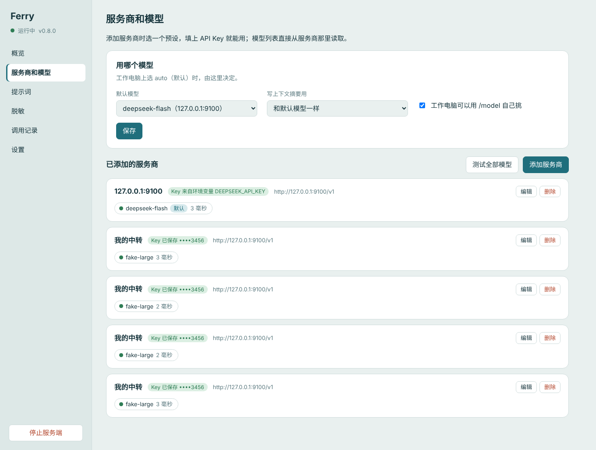

# Ferry

**一个能在受限的公司电脑上用的编码 agent，用法像 Claude Code / Cursor CLI：在 cmd 里输入 `ferry`，用中文说要做什么，它读代码、改文件、跑命令。**

A Claude-Code-style coding agent for locked-down Windows PCs: the agent runs on the work computer, a small server you control holds the API keys, builds the prompt and calls the model, and every request leaving the PC stays under 1 MB.

[](https://github.com/wvans123/ferry/actions/workflows/ci.yml)

```
C:\my-project> ferry

  Ferry v0.13.0  server ferry.example.com
  Files and history stay on this machine. The server builds the prompt and calls the model.
  memory: 3 (/memory)  ·  subagents on  ·  /help for commands (/goal /tasks /cost /rewind)

> 登录接口在密码错误时返回 500，帮我查一下原因并修好
  ● search "password" in src ... read AuthController.java ... edit AuthService.java
    Allow edit?  → Allow once / Allow all file changes / Deny
  原因是 ……，已改 AuthService.java 第 42 行，并补了一个测试，mvn test 通过。
                                                           ask before edits and commands (shift+tab)
```

**适合这样的环境**：
- 公司电脑对外的单个请求不能太大（Ferry 每个请求都不超过 1 MB）；
- 公司电脑上不想放模型的 API Key；
- 用哪个模型想由自己决定，比如 DeepSeek、Kimi、通义、智谱，或者任何 OpenAI 兼容接口。

## 目录

- [它是怎么工作的](#它是怎么工作的)
- [先选一种部署方式](#先选一种部署方式)
- [服务端：装在哪、怎么装](#服务端装在哪怎么装)
- [工作电脑：装客户端](#工作电脑装客户端)
- [日常使用](#日常使用)：命令、斜杠命令、权限、记忆、子 agent、联网、浏览器、撤销
- [自己动手扩展](#自己动手扩展)
- [设置一览](#设置一览)
- [出问题了怎么办](#出问题了怎么办)
- [安全须知](#安全须知)
- [设计](#设计)、[开发](#开发)、[离商业级还差什么](#离商业级还差什么)

## 它是怎么工作的

```
工作电脑                                       Ferry 服务端（你自己的电脑或服务器）             模型
┌──────────────────────────────┐   只传新增部分   ┌──────────────────────────────┐            ┌──────────┐
│ ferry（agent）                │ ── 每次 ≤ 1MB ──> │ 拼回完整对话、加团队提示词、   │ ─────────> │ DeepSeek │
│ 读写文件、执行命令、记忆、权限 │ <── 逐字返回 ──── │ 选模型、（可选）脱敏、存 Key  │ <───────── │ Kimi ... │
└──────────────────────────────┘                  └──────────────────────────────┘            └──────────┘
```

- **干活的在工作电脑上**：agent 引擎是开源的 [pi](https://github.com/earendil-works/pi)，Ferry 在它上面加了权限、记忆、子 agent、联网、浏览器、斜杠命令等扩展。代码、对话记录、记忆都留在工作电脑上。
- **服务端只负责"问模型"这一步**：把工作电脑传来的新增内容拼回完整对话，加上团队提示词，选模型，然后调用。API Key 只在服务端。
- **为什么每次只传一点**：长对话的上下文会超过 1 MB，所以 Ferry 每轮只上传新增的消息，太大的拆成 512 KB 的小块，服务端再拼起来。

## 先选一种部署方式

| 你的情况 | 部署方式 | 要多久 |
|---|---|---|
| 就一台电脑，能直接访问模型 API | **单机**：装好就用，服务端由 ferry 自动在本机启动 | 5 分钟 |
| 公司电脑受限，家里或自己有一台 Windows 电脑 | **家里电脑当服务端** + Cloudflare 域名，工作电脑连过来 | 30 分钟 |
| 同上，但手边是 Mac | **Mac 当服务端** + Cloudflare 域名 | 30 分钟 |
| 要一直在线，或要用 Claude / OpenAI | **Linux 云服务器** + HTTPS | 30 分钟 |

**用哪家模型**：在服务端管理页里选，工作电脑不用管。
- **Claude**（Opus 5.5 / Sonnet 5.5 / Haiku 5.5）：走 Anthropic 自己的接口，带提示词缓存。agent 的长对话里每轮重复发送的前缀按缓存价计费，Opus 5.5 缓存命中的价格是正常输入的 1/20。
- **GPT**（gpt-6.1-sol 等）：走 OpenAI 接口，OpenAI 会自动缓存。
- 也可以用 DeepSeek、Kimi、通义、智谱，或者任何 OpenAI 兼容接口。

**为什么每次调用都有几十上百 k token**：模型不记得上一轮，agent 每走一步（读个文件、跑条命令）都要把整段对话重新发一遍，Claude Code、Cursor、Codex 都一样。省钱靠两件事：
- **提示词缓存**：重复的那部分按缓存价算（Claude 是原价的 1/20，GPT、DeepSeek 约 1/10）。管理页"用量和费用"能看到每个模型的缓存命中。缓存命中一直是 0 的模型最贵。
- **Claude 走中转**：Claude 只缓存请求里标记过的部分。服务端会自动给 OpenAI 兼容中转后面的 Claude 加上标记（中转不认的话自动去掉）。中转如果也支持 `/v1/messages`，在管理页把它的"接口格式"改成 Anthropic 更好，点"测试"会告诉你支不支持。
- 另外，上下文设小一些（`/context 200k`）会更早写摘要，每次发的也就少。

**同一个模型有几家服务商**（比如 Claude 既走官方又走中转）：名字一样的模型自动合成一组，工作电脑上只看到一个。每个会话固定用一家（这样提示词缓存有效）；同时有几个会话时，新会话分给当前最闲的那家；一家出错（限流、超载、Key 失效、连不上）就自动换另一家，那家先歇一会儿。管理页上这类模型旁边标着"⇄ 2 家"。

**上下文长度**：每个模型能装多少，在管理页 → 服务商和模型 → 编辑里改（"上下文"和"最大输出"两栏，旁边还能填价格）。预设值：Claude 1M，GPT 400k（gpt-6.1-sol 最多能收约 92 万输入 token，但一次请求超过 27.2 万时按更高的单价算，输入价翻倍），deepseek-flash 1M。这是上限；工作电脑上用 `/context` 在上限以内挑一个常用的（128k、200k、300k……），省钱又不会超。

Anthropic 和 OpenAI 的 API 不对中国大陆和香港提供服务。要用这两家，服务端得放在它们支持的地区，比如海外的云服务器，见 [DEPLOY-LINUX.md](docs/DEPLOY-LINUX.md)。

## 服务端：装在哪、怎么装

### 单机（服务端和客户端在同一台电脑）

需要 Node.js 22+ 和 Python 3.11–3.14。所有命令在 **cmd** 里执行。

1. 下载 [Releases](https://github.com/wvans123/ferry/releases/latest) 里的 `ferry-windows-x.y.z.zip`，右键"全部解压"。安装包是离线的，不需要 npm、PyPI，也不需要 venv。
2. 安装：
   ```bat
   cd /d %USERPROFILE%\Downloads\ferry-x.y.z
   node client\bin\ferry.mjs install
   ```
3. 设置 API Key，然后**重新打开 cmd**：
   ```bat
   setx DEEPSEEK_API_KEY sk-你的key
   ```
4. 检查并开始用：
   ```bat
   ferry doctor
   cd /d C:\你的项目
   ferry
   ```

每次运行 `ferry`，它都会在本机后台启动一个服务端，退出时一起关掉。截图式的详细步骤见 [INSTALL-WINDOWS.md](INSTALL-WINDOWS.md)。

### 家里的 Windows 电脑 / Mac / Linux 服务器

| 服务端在 | 步骤 |
|---|---|
| Windows | [docs/DEPLOY-WINDOWS.md](docs/DEPLOY-WINDOWS.md)：用安装包装服务端 → 桌面图标打开管理页 → 填 API Key → Cloudflare Tunnel 给它一个域名 |
| Mac | [docs/DEPLOY-MAC.md](docs/DEPLOY-MAC.md)：`pipx install` → 开机自启脚本 → Cloudflare Tunnel |
| Linux | [docs/DEPLOY-LINUX.md](docs/DEPLOY-LINUX.md)：`pipx install` → systemd → Caddy 自动 HTTPS |

都装好后，服务端有一个**管理页**，只能在服务端那台电脑上打开：Windows 上双击桌面的 Ferry Server，或者运行 `ferry-server --ui`。



| 管理页 | 能做什么 |
|---|---|
| 概览 | 工作电脑要用的登录命令（一键复制，带令牌）、流量图、最近的调用 |
| 服务商和模型 | 选预设（DeepSeek、Kimi、智谱、通义、火山、硅基流动、各家编程套餐、Claude、OpenAI、OpenRouter、本机 Ollama、自定义），**只填 API Key**；读出服务商的模型列表，勾选要用的；选默认模型和写摘要用的模型 |
| 提示词 | 所有工作电脑都会带上的团队提示词，可以按项目写 |
| 脱敏 | 默认关闭。打开后，敏感词表和内网 IP、邮箱、手机号、Key 这类内容会先换成占位符再发给模型，回复里再换回来（只对 OpenAI 兼容接口生效，Claude 原生接口不做脱敏） |
| 调用记录 | 每次调用的项目、模型、大小、token、耗时，可以点开看详情 |
| 设置 | 外网地址、服务端存不存对话、请求上限、联网代办、开机启动、换令牌 |

API Key 存在服务端的 `secrets.toml` 里，任何接口都只显示最后 4 位。

## 工作电脑：装客户端

工作电脑上只装客户端，需要 Node.js 22+，不需要 Python。

**方式一：安装包**（推荐，离线，已经带好全部依赖和 fd、rg）

```bat
cd /d 解压出的 ferry-x.y.z 文件夹
node client\bin\ferry.mjs install --client-only
```

**方式二：git clone**（要能访问 npm）

```bat
git clone https://github.com/wvans123/ferry && cd ferry
npm ci
node client\bin\ferry.mjs install --client-only
```

公司网络要走代理的话，先执行 `npm config set https-proxy http://代理:端口`。

**然后连到服务端**：在服务端管理页的"概览"里复制登录命令，粘贴到工作电脑的**新** cmd 窗口里运行，再检查一遍：

```bat
ferry login https://ferry.example.com 你的令牌
ferry doctor
```

`ferry doctor` 全是 OK 就可以用了。

**好几台电脑都要登录**：在管理页"设备和手机"里给每台电脑**添加设备**，每台拿到自己的令牌和登录命令（令牌只显示一次）。某台电脑丢了或不用了，点"作废"，只有它连不上。

**更新**：都是 `ferry update`。用安装包装的，从 GitHub 下载新的安装包；用 git clone 装的，自动执行 `git pull`、`npm ci` 和重新安装（想改用安装包：`ferry update --release`）。有新版本时，ferry 启动时会提醒你。

**公司网关先要你确认**：如果服务端地址被公司网关拦下，要你先确认一下（"访问提醒"页），ferry 会自动在浏览器里打开那一页。你点"继续"后，它自己接着启动。想一劳永逸，就请 IT 把服务端地址加进白名单。

## 日常使用

在项目文件夹里输入 `ferry`，然后直接用中文说要做什么。

### 键盘

| 按键 | 作用 |
|---|---|
| Enter | 发送；Shift+Enter 或 Ctrl+J 换行 |
| **Shift+Tab** | 切换权限模式（见下文） |
| Esc | 打断 agent 正在做的事 |
| agent 干活时 Enter | 你的话排队，等 agent 这一步做完插进去（输入框上方显示 `Steering: …`） |
| 空行再按 Enter | **立即插话**：停下正在写的回答，没开始的工具调用不再执行（正在跑的命令让它跑完），马上把你的话连同"你被打断了，先重新规划"的说明交给 agent |
| Alt+Enter / Alt+↑ | 等 agent 全部做完再发 / 把排队的话拿回输入框改（插话还在等命令跑完时，Esc 也会把话放回输入框） |
| Ctrl+C | 清空输入框；两秒内再按一次退出（Ctrl+D 也能退出） |
| `?` | 只输入一个问号回车：显示命令和快捷键 |
| Ctrl+O / Ctrl+T | 展开或收起工具输出 / 模型的思考过程 |
| Ctrl+L | 选模型 |
| `/` | 列出斜杠命令 |
| `@` | 引用文件（输入文件名会自动补全） |
| `!命令` | 自己执行一条命令，输出也会给 agent 看，比如 `!git status` |

`/help` 里也有这张表。

终端标签页的标题是 `对话内容 · 项目 · Ferry`（用 `/name` 起过名就用名字，否则用你第一句话的开头）；agent 干活时前面有 ⏳，等你确认时是 ❓，开多个标签页时一眼能看出哪个在等你。

### 命令行

| 命令 | 作用 |
|---|---|
| `ferry` | 在当前文件夹开始对话 |
| `ferry -c` / `ferry -r` | 接着上次的对话 / 从以前的对话里选一个 |
| `ferry -p "问题"` | 只问一句，打印回答后退出（适合放进脚本） |
| `ferry doctor` | 逐项检查：网络、令牌、模型、搜索工具 |
| `ferry config` | 查看和修改客户端设置 |
| `ferry install-electron` | 装 Electron（约 100MB）到 `%USERPROFILE%\.ferry\electron`，让 agent 能读 JS 生成的网页。从 GitHub 下载，下不动时先 `set ELECTRON_MIRROR=https://npmmirror.com/mirrors/electron/`。已经在别处装好了的话：`ferry config set electronPath <electron.exe 的完整路径>` |
| `ferry mcp list` / `ferry mcp import` | 查看用到的 MCP 服务器 / 从 Claude Desktop、Claude Code、Cursor、VS Code 导入 |
| `ferry login <地址> <令牌>` / `ferry logout` | 连到远程服务端 / 改回本机服务端 |
| `ferry update` | 更新到最新版。git clone 装的会自己 `git pull` + `npm ci`；安装包装的从 GitHub 下载（打不开 GitHub 时，在别的电脑下载 `ferry-windows-*.zip` 拷过来，`ferry update 文件.zip`）。装在哪就更新在哪；本机有服务端时一起升级，升级后重启服务端 |
| `ferry pkg install npm:<包名>` | 安装 pi 生态的扩展包（扩展、技能、命令）；`ferry pkg list` / `remove` |
| `ferry --version --all` | 显示 Ferry 和 pi 的版本 |

### 斜杠命令

只留常用的，输入 `/` 可以挑选，`/help` 列出全部和快捷键：

| 分类 | 命令 |
|---|---|
| 对话 | `/new` 开始新对话 · `/resume` 回到以前的对话 · `/name <名字>` 给这次对话起名 · `/session` 这次对话的信息 · `/compact [保留什么]` 现在就压缩上下文 · `/rewind` 回到之前某条消息 |
| 干活 | **`/goal <目标>`** 一直做到完成（见下文）· `/tasks` 后台任务 |
| 知识 | `/memory` 看记住了什么 · `/memory <内容>` 记住一句话 · `/skills` 它会哪些技能 |
| 信息 | `/context [大小]` 上下文用了多少，带大小就改（如 `/context 400k`）· `/cost` 花了多少 token 和钱 · `/status` 连接、模型、规则文件，并做一次快速检查 |
| 设置 | `/config` 常用设置 · `/model` 选模型 · `/mcp` MCP 服务器 · `/quit` 退出 |

- **`/rewind`**：选你之前发的一条消息，回到它发出之前。可以选只退对话、只退文件，或两样一起退（像 Claude Code）。那条消息会放回输入框，改一改再发。退回去的那段对话还留在记录里。文件只管 agent 用 edit/write 改的，命令造成的改动请用 git。
- **`/memory`** 不带内容是查看，带内容是存一条（默认存在这个项目；`/memory user 内容` 存到所有项目）。平时直接说"记住……"也行。
- 底栏的 `23%/500k (auto)`：上下文用了 23%，上限 500k；`(auto)` 表示快满时自动写摘要压缩。右边的 `auto` 是模型名，意思是"由服务端选模型"（管理页里设的默认模型）。
- **`/context 400k`** 改当前模型的上下文长度，马上生效并记住；`/context auto` 回到服务端的设置。上下文越大，压缩前能留的历史越多，但每次请求越贵。不能超过模型本身支持的长度。

pi 自带的其他命令（`/tree`、`/fork`、`/export`、`/share`、`/login`……）不再列出，用不上。写代码用的 `/init`、`/review`、`/commit`、`/test` 等放在 [examples/commands/](examples/commands/)，需要的话拷进 `%USERPROFILE%\.ferry\commands\`。自己写命令见[自己动手扩展](#自己动手扩展)。

### /goal：给一个目标，它一直做到完成

```
> /goal 把 docs 文件夹里所有文档的术语统一成《术语表.md》里的写法，改完列出改了哪些文件
```

- 设定后 agent 自己连续干：每停一次，Ferry 就让它对照目标检查做完了什么、接着做下一步。
- 完成要有证据（文件内容、命令输出、测试结果）。它用 `goal_update` 报告"完成"或"卡住了需要你"，才会停下。
- 底栏一直显示：`◎ goal pursuing · 12m · 340k/2M tokens · 7 turns`。
- `/goal` 查看状态，`/goal pause` / `resume` / `clear` 暂停、继续、清除。
- `/goal budget 2m` 设 token 预算，用完了它会写一份进度报告再停。另外默认最多 100 轮（`ferry config set goalMaxTurns ...`）。
- 目标写起来长的话，先写进一个文件，再 `/goal 目标.md`。
- 按 Esc 会暂停目标；目标进行中你也可以随时插话纠正方向。

参考了 Codex 的 goal mode 和 Claude Code 的 `/goal`。

### 后台任务和子任务

- **后台命令**：长时间运行的命令（开发服务器、监听、长时间的构建或测试）用 `job_start` 放到后台，agent 接着干别的，用 `job_output` 查看进度。
- **后台子 agent**：`task` 加上 `background`，子 agent 在后台做一件独立的事，做完自动把报告交回来。
- **子 agent**：agent 自己判断要不要把一件事交给子 agent（`task`），子 agent 用全新的上下文干完，只把报告带回来。对话里会出现一个小框显示它在做什么。
- **待办清单**：多步的活，agent 先列待办（输入框上方的 `To-do (1/3 done)`），做一步勾一步。这和 Cursor 里的待办列表是一回事。
- `/tasks` 一次看全：待办清单、子 agent（正在跑的和跑完的）、后台命令，可以看输出、停止。正在跑的显示在输入框上方。任务结束时会通知你，agent 在你下一条消息时也会知道。退出 ferry 时，后台任务一起停掉。

### 权限：该问的才问

**Shift+Tab** 在五种模式之间切换，底栏显示当前模式：

| 模式 | 改文件 | 执行命令 |
|---|---|---|
| 默认 | 问 | 只读命令（`git status`、`dir`、`rg`……）不问，其他问 |
| 自动改文件 | 项目文件夹里的不问 | 同上 |
| auto | 项目文件夹里的不问 | 规则定不了的，交给服务端的一个模型判断（管理页 → 设置里选，比如 DeepSeek），它说"明显安全"才放行，否则照常问你。危险操作不经判断，直接问 |
| 只读规划 | 不允许 | 只允许只读命令 |
| 全部放行 | 不问 | 不问 |

- 确认框里可以选"以后都允许这类命令"，比如以 `npm test` 开头的命令。Ferry 会按项目记住。
- 危险操作（删整个目录、`git push --force`、`git reset --hard`、`curl … | sh`……）在除"全部放行"以外的模式下都会问，并说明危险在哪。
- 改项目文件夹以外的文件，总要先确认。
- `.env`、`.ssh` 这类路径永远不碰（`ferry config set blockedPaths ...` 可改）。
- 启动时用哪种模式：`ferry config set permissionMode acceptEdits`。

### agent 还能做什么

| 能力 | 说明 |
|---|---|
| 任务清单 | 多步任务先列计划，输入框上方显示进度 |
| 记忆 | 跨对话记住你的偏好、纠正和项目里的决定。说"记住……"或"忘掉……"即可。分你个人（这台电脑上所有项目）和这个项目两层，存在工作电脑 `%USERPROFILE%\.ferry\memory`，都是可以直接改的 Markdown 文件 |
| 全局记忆 | 服务端管理页"设备和手机"里打开后，多一层 global：存在服务端，你所有电脑共用（偏好、习惯、术语）。工作内容不往这里放，项目记忆照旧只在本机。`/memory global <内容>` 也能直接存一条 |
| 子 agent | "在整个代码库里找……"这类活交给上下文全新的子 agent，只把结论带回来，主对话不会被撑大。几个子 agent 可以同时跑 |
| 联网 | `web_search`（Bing）、`web_fetch`（读网页），在工作电脑上执行，走公司代理，受公司网关管。读网页时按网站询问 |
| 读 JS 网页 | 有些网页要等 JavaScript 跑完才有内容，`web_fetch` 读到的是空的。装了 Electron（`ferry install-electron`）后，这种页面会自动交给一个看不见的浏览器打开、等它加载完再读文字（`web_render`）。只读不点，不带登录和 cookie，每个页面用完即清 |
| 不许打开的网站 | `ferry config set blockedSites mail.corp.com,chat.corp.com,pan.corp.com`：这些网站和它们的子域名，`web_fetch` 和 `web_render` 都不会打开，跳转过去的也拦下 |
| 浏览器 | `ferry config set browser true` 后，agent 能操作电脑上的 Edge：打开网页、点击、填表、读页面 |
| 长输出 | 命令输出太长时，全文存到文件，只给模型看开头和结尾，需要时它自己去读 |
| 压缩和找回 | 对话太长时自动写摘要；之后需要原文时，用 `history_search` 在本地完整记录里找回 |
| 以前的对话 | 说"看看我昨天那个对话里定了什么"，它会用 `past_conversations` 列出、搜索、读取这台电脑上以前的对话（默认这个文件夹的，也可以搜全部） |
| 回退 | `/rewind` 回到之前某条消息：对话、agent 改过的文件，或两样一起 |
| 思考 | Claude 和 GPT 默认打开思考（中等）。难的活可以调高：`/config` → `thinking` |
| 读图 | 告诉它图片的路径就行，它会用 read 工具读出图片交给模型（模型要支持看图，Claude、GPT、deepseek-flash 都支持） |
| 花费 | 底栏显示本次对话花了多少钱；`/cost` 看明细；服务端管理页的"用量和费用"按天、按项目、按模型汇总 |
| 提醒 | 一个请求超过 30 秒才做完时，会响一声并弹出 Windows 通知 |
| 手机通知 | 目标完成或卡住、做了 5 分钟以上的活做完、确认框等你超过 5 分钟时，推到手机（iPhone 用 Bark：管理页 → 设置 → 手机通知，贴上 Bark 的地址）。只发一句话，不带对话内容。打开了手机控制台的话，点通知直接进控制台 |
| 手机控制台 | 管理页"设备和手机"里设密码、打开后，手机浏览器访问 `外网地址/m`：看到每台电脑上的 ferry 在做什么（项目、对话、目标、正在跑的命令、最近一句话），可以**停止**，也可以**允许 / 拒绝**它在等的确认。允许要那台电脑先同意：`ferry config set remoteApprove true`；危险操作和项目以外的操作只能在电脑上批准 |
| Office 文件 | 读 Word（含修订痕迹和批注）、Excel、PowerPoint、PDF；按修订方式改 Word（像 change request 那样显示删了什么、加了什么）；改 Excel 单元格；从 Markdown 新建 Word、从表格新建 Excel。直接处理文件，不需要装 Office，也不会去操作屏幕上的窗口 |
| 批量派活 | "把这个文件夹里 40 篇稿件每篇看一遍"：每篇派一个子 agent，同时最多 3 个（`maxParallel`），报告汇总到一个文件。服务端也限制每个用户同时的模型请求数（管理页 → 设置），多的排队，不会把服务端压垮 |
| 省 token | 上下文超过 80k（`trimOldOutputs`）时，很久以前的长工具输出（读过的大文件、长命令输出）换成一行说明，最近 6 个保留；需要时它会重读，`history_search` 也能找回原文 |

## Agent 团队

想要"负责人派活、调研/分析/写 PPT 各管一摊、互相留言"的团队，用 [Paperclip](https://github.com/paperclipai/paperclip) 当看板（组织架构、任务、评论、仪表盘，在工作电脑本机打开），每个成员都跑 Ferry，模型调用照样走你的 Ferry 服务端：

```powershell
npx paperclipai onboard --yes          # 第一次；以后 npx paperclipai run（需要 Node 24.11+）
ferry team add Lead --title "负责人" --about "拆解目标、派活、检查、汇总"
ferry team add Researcher --title "调研" --about "查资料，结果写成 research/*.md"
ferry team task "调研三种方案并写汇报 PPT" --to Lead
```

成员有 `team` 工具：派子任务、等它完成后被自动叫醒、留言、改状态；项目记忆全队共享，每个成员还有自己的角色记忆。详见 [docs/TEAM.md](docs/TEAM.md)。

## 自己动手扩展

不用写代码，放几个文本文件就行。仓库的 [examples/](examples/) 里每样都有现成的例子，详细说明见 [docs/CUSTOMIZE.md](docs/CUSTOMIZE.md)。

| 想做的事 | 放一个文件 |
|---|---|
| 让 agent 了解项目 | 项目根目录的 `AGENTS.md`（也可以让 agent 读完项目自己写） |
| 加一个斜杠命令 | `.ferry\commands\standup.md` → `/standup` |
| 教它一类任务的做法 | `.ferry\skills\release-notes\SKILL.md` |
| 加一个专门的子 agent | `.ferry\agents\security-reviewer.md` |
| 改完文件自动格式化、检查 | `.ferry\hooks.json` |
| 哪些命令不用问、哪些禁止 | `.ferry\permissions.json` |
| 接数据库、Jira、内部系统 | MCP：`%USERPROFILE%\.ferry\agent\mcp.json`（你的）或项目里的 `.ferry\mcp.json`、`.mcp.json`；`ferry mcp import` 从别的应用导入 |

- 放在项目的 `.ferry\` 下只管这个项目，可以提交进仓库给团队用；放在 `%USERPROFILE%\.ferry\` 下对你所有项目生效。
- Claude Code 的 `.claude\commands`、`.claude\agents`、`.claude\skills`、`CLAUDE.md` 也直接能用。

## 设置一览

**客户端**：在 ferry 里输入 `/config` 挑着改；或者 `ferry config` 查看，`ferry config set <名字> <值>` 修改。

| 名字 | 默认 | 作用 |
|---|---|---|
| `permissionMode` | `default` | 启动时的权限模式：`default` / `acceptEdits` / `plan` / `bypass` |
| `thinking` | `medium` | Claude 和 GPT 想多久再回答：`low` / `medium` / `high` / `xhigh`。越高越适合难题，但更慢更贵 |
| `memory` | `true` | 跨对话的记忆 |
| `web` | `client` | 联网工具在哪执行：`client`（这台电脑）/ `server`（服务端代办，需服务端开启）/ `off` |
| `browser` | `false` | 让 agent 操作本机浏览器（Edge / Chrome） |
| `goalMaxTurns` / `goalBudget` | `100` / `0` | `/goal` 最多轮数和 token 预算（如 `2m`，0 = 不限） |
| `notify` | `true` | 长请求结束时响铃加通知 |
| `phoneNotify` | `true` | 让服务端推手机通知（服务端要先在管理页设好 Bark） |
| `remoteApprove` | `false` | 允许在手机控制台上批准这台电脑在等的操作（危险操作除外）；停止和拒绝总是可以 |
| `render` | `true` | 用隐藏的浏览器读 JS 网页（`web_render`，需要先 `ferry install-electron`） |
| `blockedSites` | 空 | 永远不打开的网站（含子域名），比如邮箱、通讯、网盘 |
| `blockedPaths` | `.env,.ssh,id_rsa,secrets,credentials` | 永远不读、不改、不在命令里出现的路径 |
| `proxy` | 空 | 连服务端用的代理，空 = 用 `HTTPS_PROXY` 环境变量 |

很少需要改的（`ferry config --all` 或 `/config` → More settings）：`trimOldOutputs`（上下文多大时开始省略旧工具输出，默认 80k，0 = 不省略）、`maxParallel`（同时跑几个子 agent，默认 3）、`phoneAfterSeconds`（多久算"做了很久"，默认 300 秒）、`subagents`（子 agent）、`bigOutputBytes`（长输出存文件的阈值）、`notifyAfterSeconds`、`updateCheck`、`browserPath`、`browserHeadless`、`chunkBytes`、`electronPath`（Electron 在哪，空 = 自己找）、`renderWaitMs`（web_render 最多等页面多久，默认 12 秒）、`phoneConsole`（在手机控制台上显示这台电脑，默认开；服务端没开控制台时什么也不报）。上下文长度用 `/context` 改，存在同一个文件里。

**服务端**：大多在管理页里改，存在服务端数据目录的 `server.toml`。也可以用环境变量：

| 环境变量 | 作用 |
|---|---|
| `FERRY_SERVER_HOME` | 数据放哪，比如 `D:\ferry\server`（令牌、Key、models.toml、日志） |
| `DEEPSEEK_API_KEY` 等 | 也可以用环境变量给 Key（优先于管理页里填的） |
| `FERRY_SESSION_STORE` | 服务端存不存对话：`memory`（默认）/ `disk` / `none` |
| `FERRY_REDACT` | `1` 打开脱敏（默认关闭） |
| `FERRY_WEB` | `1` 允许服务端替工作电脑联网（默认关闭） |

多用户的服务器改用完整配置文件 `ferry-server.toml`，参考 [server/ferry-server.example.toml](server/ferry-server.example.toml)。

## 出问题了怎么办

先运行 `ferry doctor`，它会逐项检查，并告诉你下一步该做什么。

| 看到 | 原因和办法 |
|---|---|
| `the company network gateway wants a confirmation` | 公司网关要你先确认。运行 `ferry`，它会在浏览器里打开确认页；长期办法是请 IT 加白名单 |
| `cannot reach the server` | 浏览器能打开但 ferry 连不上，通常是浏览器走了公司代理。执行 `setx HTTPS_PROXY http://代理:端口`，然后重开 cmd |
| `unable to get local issuer certificate` | 公司代理会解开 HTTPS 再加密。把公司根证书导出成 .pem，执行 `setx NODE_EXTRA_CA_CERTS C:\路径\证书.pem` |
| `The Ferry server did not get this request: ...` | 请求在半路被挡了，服务端的调用记录里看不到。详情记在 `%USERPROFILE%\.ferry\logs\blocked.log`；`ferry doctor --upload` 测多大的上传能通过（小的能过、大的不行，就按它的提示把 `chunkBytes` 调小）。后面那句会说是谁：**Cloudflare 的机器人防护**（按提示在 Cloudflare 后台关掉 Bot Fight Mode，或给 Ferry 的域名加一条跳过规则）、**公司网关**（Ferry 会在浏览器里打开服务端地址，网关的确认页会出现在那里，确认后重发）、或公司代理。服务端的调用记录里看不到这类请求 |
| `a Cloudflare Access login page answered` | 服务端地址前挡着 Cloudflare 的登录页，见 [DEPLOY-MAC.md](docs/DEPLOY-MAC.md#关于那个-cloudflare-登录页) |
| `token rejected` | 令牌不对或换过了。到管理页复制新的登录命令 |
| `HTTP 502 / 530` | 服务端那台电脑睡眠了，或者服务端、cloudflared 没在运行 |
| `model ... HTTP 401 / 402 / 403` | Key 不对 / 账户没余额 / 服务商不服务你所在的地区 |
| `fd and rg not found` | 用安装包装一次，或者把安装包里 `vendor\win32-x64\` 下的两个 exe 拷到 `%USERPROFILE%\.ferry\agent\bin\` |
| 命令输出是乱码 | 告诉我是哪条命令。PowerShell 和 Python 已经强制 UTF-8 |
| 联网返回 `000` 或连不上 | 工作电脑的命令行上不了外网。让 agent 用 `web_fetch`，不要用 curl |

## 安全须知

- **服务端能看到对话原文**（`session_store = "none"` 时处理完就丢），所以服务端必须是你信得过的机器，并且只用 HTTPS 访问。
- **脱敏默认关闭**。打开后，也只有词表和内置规则命中的内容会被替换，其他信息照样会发给模型。脱敏能降低风险，但不是保证。公司明确不允许外发的内容，就不要交给 agent。
- **联网默认在工作电脑上执行**，受公司网关管，Ferry 不会替你点掉网关的确认页。改成服务端代办（`web = server`），等于让工作电脑经你的服务端访问外网，开启前请确认公司规定允许。
- **令牌**存在工作电脑的 `%USERPROFILE%\.ferry\config.json` 里。泄露了就在管理页换一个新的；用"添加设备"发的令牌，作废那一台即可。
- **手机控制台**能从外网打开，所以有自己的密码（只存哈希，错 5 次锁 10 分钟），登录状态保存 30 天，换密码就全部失效。手机上批准操作，等于远程授权工作电脑做事：默认关闭，要在那台电脑上 `remoteApprove` 打开，危险操作仍然只能在电脑上批准。从手机远程让工作电脑做事，开启前请确认公司规定允许。
- **全局记忆**存在服务端，agent 被要求只放你的偏好，不放工作内容；管理页里能看到每一条、随时删。
- 试用时请先拿一个测试文件夹和编的内容。

## 设计


| 问题 | 做法 | 代码位置 |
|---|---|---|
| 单个请求 ≤ 1MB，但长会话的上下文会超过 1MB | 客户端每轮只上传新增消息，用哈希链校验双方一致；超过 512KB 的内容拆块上传；服务端拼回完整上下文再发给模型 | `client/lib/sync.mjs`、`server/ferry_server/store.py` |
| 服务端缓存丢了怎么办 | 客户端始终保存完整记录；服务端只是缓存。校验不一致时返回 409，客户端自动全量重传 | 同上 |
| 提示词由谁决定 | 和 Cursor 一样由服务端完成最终组装：通用规则 + 按项目的规则，改完下一轮即生效，不用动客户端 | `server/ferry_server/prompt.py` |
| 敏感信息不外发（可选，默认关闭） | 词表和正则命中的内容替换成确定性占位符 `[FERRY-XXXXXXXX]`（HMAC），同一个值始终对应同一个占位符，模型看到的对话前后一致 | `server/ferry_server/redact.py` |
| 模型回复里的占位符 | 正文逐字转发，只暂扣可能是占位符开头的最多 15 个字符；工具调用参数在该轮结束时一次性还原后发出，客户端永远拿到真实路径和命令 | `server/ferry_server/stream.py` |
| 用哪个模型由服务端决定 | 客户端只看到一个 `auto` 模型；服务端按设置把干活的请求和写摘要的请求分别发给不同模型。统一走 OpenAI 兼容接口：DeepSeek、OpenAI、Claude（Anthropic 的兼容接口） | `server/ferry_server/app.py`、`config.py` |
| 服务端存不存对话 | 设置项 `session_store`：存磁盘（省流量）、只存内存、完全不存（每轮整段重传，仍按 512KB 分块，单个请求不超过 1MB） | `server/ferry_server/store.py` |
| 本地安全底线 | 禁止目录、执行前确认都在客户端执行，服务端无法绕过；拦截原因里不含受保护的名字 | `client/lib/guard.mjs` |
| 可审计 | 访问日志和审计日志只记大小、模型、脱敏计数、用量，不记对话内容 | `server/ferry_server/app.py` |
| 上下文太长 | 三层：长输出在客户端写文件，只给模型开头结尾；pi 在接近模型窗口时把旧历史写成摘要，压缩后能用 `history_search` 找回原文；服务端可以给发给模型的请求设上限（默认不设，管理页 → 设置），超了从最旧的工具输出开始删 | `client/lib/tools.mjs`、`server/ferry_server/prompt.py` |
| 记忆放哪 | 客户端：内容本来就是关于这台电脑上的代码和你的习惯；服务端只转发，换服务端不丢记忆。只有目录进系统提示，正文按需读取 | `client/lib/memory.mjs` |
| 子 agent | 在同一个进程里另起一个 pi 会话（内存里，不存盘），作为一个独立对话同步到服务端；审批对话框借用主窗口 | `client/lib/subagent.mjs` |
| 权限 | 每次工具调用先过 `decide()`：受保护路径 → 禁止规则 → 模式 → 危险命令 → 询问规则 → 只读命令 → 允许规则；复合命令按 `&&` `;` `|` 拆开逐段判断。几个工具同时要确认时排队一个一个问，前一个回答存下的规则后面的直接用 | `client/lib/permissions.mjs`、`guard.mjs` |
| 系统提示 | 用 Ferry 自己的开场和工作方式代替 pi 的（不再提 pi 文档，避免模型去翻 agent 自己的配置），保留 pi 的工具说明，加上操作系统、shell、日期、是否 git 仓库 | `client/lib/prompt.mjs` |
| 联网 | 默认在客户端执行，走公司代理，识别网关的确认页（按地址和页面文字）并报告，不点击通过；可选服务端代办：只允许 http(s)，拒绝本机和内网地址（管理页信任本机来的请求，不能让网页请求绕到它），每次跳转都重新检查，可设网站白名单 | `client/lib/web.mjs`、`server/ferry_server/web.py` |
| 公司网关要先确认 | 启动时发现服务端地址被网关转到确认页，就用浏览器打开那一页，每 2.5 秒检查一次，你确认后自动继续；会话中途确认过期，也会重新打开并提示重发 | `client/lib/gateway.mjs` |
| 跟着 pi 更新 | Ferry 只用 pi 公开的扩展接口，不改 pi 本身，所以不 fork。每周一自动检查 pi 新版本：换上新版本后在 Linux 和 Windows 上跑全部测试（含终端界面冒烟测试），都通过才提交并发布 Ferry 新版本 | `.github/workflows/update-pi.yml`、`scripts/bump_pi.mjs` |
| 斜杠命令和自定义 | pi 自带命令里用不上的，启动时从它的命令表里拿掉（只是不列出）；用户和项目的命令、技能目录通过 pi 的 `resources_discover` 事件加进去，同名时项目覆盖用户 | `client/lib/trim.mjs`、`client/lib/commands.mjs` |
| 撤销 | 每次请求里第一次 edit/write 一个文件前，把原内容按哈希存一份；`/rewind` 选一个请求，把它和之后改过的文件恢复，并告诉模型这些文件变了 | `client/lib/checkpoint.mjs` |
| 钩子 | `afterEdit` 在工具结果出来后运行，失败输出追加到工具结果里交给模型；项目的钩子文件按内容哈希征得同意，改了要重新同意 | `client/lib/hooks.mjs` |
| /goal | 目标存成会话里的一条记录（恢复对话时还在）；agent 每次要停下时（pi 的 `agent_before_settle`），如果目标还在进行，就补一条"对照目标继续"的消息并要求再跑一轮；agent 用 `goal_update` 报告完成或卡住；token 预算和轮数上限到了就要求它写进度报告 | `client/lib/goal.mjs` |
| 后台任务 | 后台命令的输出写到文件，`job_output` 读末尾；后台子 agent 是不等结果的子会话；结束时提示你，并在你下一条消息里告诉 agent | `client/lib/jobs.mjs` |
| Claude 原生接口 | 客户端按服务端说的接口类型，用 pi 自带的 Anthropic 提供方（思考、图片、缓存标记都由它处理）；同步前把每轮都会移动的缓存标记取下、服务端再放回，所以照样只传新增部分；服务端把请求转给 Anthropic，并从事件流里记下用量 | `client/lib/sync.mjs`、`server/ferry_server/app.py` |
| 费用 | 价格写在服务端的模型配置里（预设已填好 Claude 和 GPT），随模型列表下发给客户端，pi 自己累计；服务端按每次调用的用量另算一份，管理页汇总 | `server/ferry_server/usage.py` |
| 公司代理 | 客户端所有请求统一走代理（环境变量或配置项），支持 NO_PROXY | `client/lib/config.mjs` |
| 好装、好更新 | 离线安装包 + `ferry install`；`ferry update` 从 GitHub 发布页取最新版；没登录远程服务端时自动在本机启动服务端 | `client/lib/setup.mjs` |
| 不重复造轮子 | Agent 循环、工具和终端界面直接用开源的 [pi](https://github.com/earendil-works/pi)（MIT），通过它公开的 `main()` 和扩展接口嵌入，不 fork 内核 | `client/bin/ferry.mjs` |

更细的协议和取舍见 [docs/DESIGN.md](docs/DESIGN.md)。


更细的协议和取舍：[docs/DESIGN.md](docs/DESIGN.md)；上下文和记忆的方案：[docs/CONTEXT-AND-MEMORY.md](docs/CONTEXT-AND-MEMORY.md)；客户端 agent 的目标和进度：[docs/AGENT-GOAL.md](docs/AGENT-GOAL.md)；管理页的设计：[docs/ADMIN-DESIGN.md](docs/ADMIN-DESIGN.md)。

### 和 Cursor 的对应关系

| | Cursor | Ferry |
|---|---|---|
| 对话记录 | 存在客户端，每次请求带上 | 存在客户端；服务端额外缓存一份，所以每次只需传新增部分 |
| 工具执行（读写文件、命令） | 客户端 | 客户端 |
| 最终提示词组装 | 服务端（官方文档说明即使用自己的 API Key 也经服务端） | 服务端 |
| 模型调用和 API Key | 服务端 | 服务端 |
| 代码库语义检索 | 服务端索引 | 不做（要把代码上传建索引）；用 grep + 子 agent 搜索 |
| 记忆 | Memories（服务端生成，需批准） | 客户端文件，模型用 `memory` 工具读写，你可以直接改 |
| 子 agent | 有 | `task` 工具，内置 explore / general，可自定义 |
| 权限 | 有 | 四种模式、按项目记住的规则、只读命令白名单、危险命令总是问（参考 Claude Code） |
| 读网页、搜索 | 服务端执行 | 默认在工作电脑上执行（受公司网关管），可选服务端代办 |


## 开发

```bash
git clone https://github.com/wvans123/ferry && cd ferry
npm ci
pip install -e server pytest
pytest server/tests                     # 服务端单元测试
node --test "client/test/*.test.mjs"    # 客户端单元测试（权限、联网、钩子、撤销……）
python selftest/run.py                  # 端到端：假模型 + 服务端 + 客户端 + 假代理 + 假网关，跑完 GOAL.md 里的全部检查，不需要 Key
node client/bin/ferry.mjs               # 直接从源码运行
```

- 每次推送，GitHub Actions 在 Linux 和 Windows 上各跑一遍全部测试。
- main 上 `package.json` 的版本号变了，测试通过后自动打包 Windows 离线安装包并发布，`ferry update` 就能取到。
- **跟着 pi 更新**：每周一自动检查 pi 的新版本（[update-pi.yml](.github/workflows/update-pi.yml)，也可以手动运行）。有新版本就换上，跑全部测试（含终端界面测试），都通过才发布；没通过什么都不改，GitHub 会发邮件通知。Ferry 只用 pi 公开的扩展接口，不 fork、不改 pi 本身。

```
client/      ferry 命令行（Node.js）
  bin/       入口 ferry.mjs
  lib/       同步 sync · 权限 permissions + guard · 系统提示 prompt · 记忆 memory · 子 agent subagent
             任务清单和长输出 tools · 联网 web · 公司网关 gateway · 浏览器 browser · 撤销 checkpoint
             钩子 hooks · 斜杠命令 commands · fd/rg toolbins · 安装和更新 setup
  commands/  内置斜杠命令（Markdown）
  test/      客户端单元测试
server/      ferry-server（Python / FastAPI）：会话缓存、提示词组装、脱敏、流式还原、模型适配、管理页、联网代办
examples/    自己扩展用的例子：命令、技能、子 agent、钩子、权限、MCP
selftest/    端到端自测：假模型、假代理、run.py
deploy/      部署：Mac 开机自启、Linux systemd、Caddy
scripts/     打包 Windows 离线安装包、跟进 pi 版本
docs/        部署指南、扩展指南、设计文档
```

## 离商业级还差什么

v0.13 是一个可以自用、可以演示的原型：47 个单元测试（服务端 32、客户端 15）和 43 项端到端测试覆盖，在 Linux 和 Windows 上自动跑。离商业产品还差这些：

| 方面 | 现状 | 还缺 |
|---|---|---|
| agent | /goal 长任务、后台任务、权限模式、记忆、子 agent、任务清单、斜杠命令、技能、钩子、MCP、回退、联网、浏览器、读图、思考、可调上下文长度 | 命令在沙箱里跑（Codex 的做法） |
| 服务端 | 增量同步、组装提示词、选模型、Claude 原生接口和提示词缓存、用量和费用、可逆脱敏（OpenAI 兼容接口）、管理页 | GPT 的 Responses 接口、服务端摘要 |
| 可靠性 | 缓存丢失自动恢复、版本协商、自动跟进 pi 更新 | 多实例部署（目前是单机 SQLite）、数据备份 |
| 安全 | 多用户隔离、恒定时间令牌比较、拒绝弱密钥、日志不含正文、管理页只限本机 | 限流、令牌过期、客户端令牌存进系统凭据库 |
| 真实环境 | Linux 和 Windows 上用假模型、假代理、假网关验证；作者的工作电脑经 Cloudflare 连通 | 更多公司网络环境下的验证 |
| 交付 | 离线安装包、一条命令安装和更新、自动发版 | 代码签名、安装向导（.msi） |

## 致谢

[pi](https://github.com/earendil-works/pi)（MIT）· [Playwright MCP](https://github.com/microsoft/playwright-mcp) · [ripgrep](https://github.com/BurntSushi/ripgrep) · [fd](https://github.com/sharkdp/fd) · [FastAPI](https://fastapi.tiangolo.com/) · [HTTPX](https://www.python-httpx.org/) · [undici](https://github.com/nodejs/undici)
