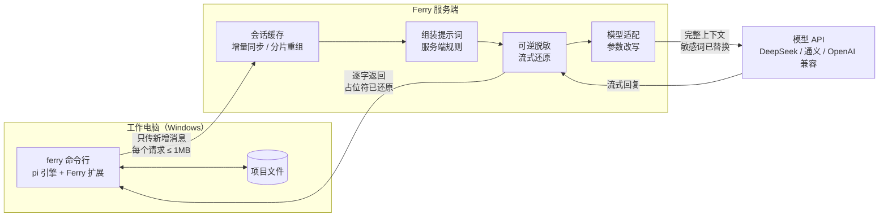

# Ferry

**在受限的公司电脑上用的编码 agent，像 Cursor CLI 一样在 cmd 里对话。**
A Cursor-style coding agent for locked-down Windows PCs: the CLI does the work locally, a server you control builds the prompt, redacts secrets and picks the model, and every request stays under 1 MB.

[](https://github.com/wvans123/ferry/actions/workflows/ci.yml)

适合这样的环境：

- 公司电脑对外的**单个请求不能超过 1MB**；
- **敏感信息**（项目代号、内网地址、邮箱）不应原样发给外部模型；
- 模型的 **API Key 不想放在公司电脑上**，用哪个模型想由自己的服务器决定。

```
C:\my-project> ferry

  Ferry v0.11.0  server on this computer
  Files and history stay on this machine. The server builds the prompt and calls the model.
  memory: 3 (/memory)  ·  subagents on  ·  ferry config to change

> 读一下 notes.txt，然后新建 summary.md 总结它
  （agent 读文件；要写文件时先弹出 Allow / Deny 让你确认）
  已新建 summary.md。
                                                                            (ferry) auto
```

## 在 Windows 上三步用起来

需要 Node.js 22+ 和 Python 3.11–3.14（只用来跑本机服务端；只连远程服务端时可以不装）。所有命令在 **cmd** 里执行。

**1. 下载** [Releases](https://github.com/wvans123/ferry/releases/latest) 里的 `ferry-windows-x.y.z.zip`，右键"全部解压"。

**2. 安装**（离线，不需要 venv、npm、PyPI）：

```bat
cd /d %USERPROFILE%\Downloads\ferry-x.y.z
node client\bin\ferry.mjs install
```

**3. 设置 Key，重新打开 cmd，开始用：**

```bat
setx DEEPSEEK_API_KEY sk-你的key
```

```bat
ferry doctor
cd /d C:\你的项目
ferry
```

`ferry doctor` 全是 OK 就说明 Key、网络、模型都没问题。逐步截图式说明和排错见 [INSTALL-WINDOWS.md](INSTALL-WINDOWS.md)。

用 `git clone` 拿到的代码没有依赖包：在文件夹里先 `npm ci`（要能访问 npm，公司网络先设好 `npm config set https-proxy ...`），再 `node client\bin\ferry.mjs install`。`install` 会从 GitHub 下载文件搜索要用的 `fd` 和 `rg`；下载不了时 `ferry doctor` 会提示，改用 Releases 里的安装包就行（已经带好）。

### 常用命令

| 命令 | 作用 |
|---|---|
| `ferry` | 在当前文件夹开始对话（快速按两次 Ctrl+C 退出） |
| `ferry -p "问题"` | 只问一句，打印回答后退出 |
| `ferry doctor` | 逐项检查，最后给模型发一个小请求确认能用 |
| `ferry update` | 更新到 GitHub 上的最新版（访问不了 GitHub 时：`ferry update 下载好的.zip`） |
| `ferry login 服务器地址 令牌` | 改用另一台机器上的服务端（前面有 Cloudflare Access 时加 `--header "CF-Access-Client-Id: ..."`） |
| `ferry logout` | 回到本机服务端 |
| `ferry config` | 查看客户端设置；`ferry config set memory false` 这样改 |

对话里：**Shift+Tab 切换权限模式**，`/permissions` 看和删"以后都允许"的规则，`/new` 新开对话，`/compact` 手动压缩上下文，`/memory` 看记住了什么，`/settings` 改界面和压缩设置，Shift+Enter（或 Ctrl+J）换行。`ferry -c` 接着上次的对话，`ferry -r` 选一个以前的对话。

## 客户端 agent 能做什么

干活的 agent 跑在工作电脑上（[pi](https://github.com/earendil-works/pi) 引擎加 Ferry 的扩展），服务端只负责"问模型"这一步。所以工具、记忆、子 agent、上下文管理都在客户端，参考 Claude Code、Codex 和 pi 的做法：

| 能力 | 怎么用 | 参考 |
|---|---|---|
| **文件和命令** | `read` `edit` `write` 读写文件；`bash`（没有 Git Bash 时用 PowerShell）执行命令，命令在工作电脑上跑，和你自己在 cmd 里敲一样；`grep` `find` `ls` 搜索和浏览（自带 ripgrep 和 fd） | pi |
| **权限** | 四种模式，Shift+Tab 切换，底栏显示当前模式：**默认**（改文件、执行命令前问）、**自动改文件**（项目里的改动不问，命令照问）、**只读规划**（只能读和搜，先出方案）、**全部放行**。确认框里可以选"以后都允许这类命令"（比如 `npm test` 开头的都放行，按项目记住）。`git status`、`dir`、`rg` 这类只读命令不问；删目录、`git push --force`、`reset --hard` 这类危险操作除了全部放行模式都会问，并说明危险在哪；写项目文件夹以外的地方总要确认。规则也可以手写，见下文 | Claude Code 的权限模式、Codex 的审批策略 |
| **联网** | `web_search` 搜索（Bing）、`web_fetch` 读网页，默认**在工作电脑上执行**，和浏览器一样走公司代理，公司网关的规则照样生效。读网页按网站询问，可以选"以后都允许这个网站"。网关要求先确认的网站，agent 会告诉你去浏览器确认哪个地址，不会绕过。`ferry config set web server` 改为由服务端代办（服务端管理页还要打开联网），`off` 关闭 | Claude Code 的 WebFetch / WebSearch |
| **浏览器** | `ferry config set browser true` 后，agent 能驱动工作电脑上的 Edge：打开网页、点击、填表、读页面（微软的 [Playwright MCP](https://github.com/microsoft/playwright-mcp)，安装包里带好，不下载浏览器）。走工作电脑自己的网络 | Claude in Chrome、Codex 的浏览器工具 |
| **任务清单** | 多步任务时模型先列计划，输入框上方显示进度：`[x]` 完成、`[>]` 进行中 | Claude Code 的 TodoWrite |
| **记忆** | 跨对话记住你的偏好、纠正、项目里的决定。分"你个人"（所有项目）和"这个项目"两层，存在工作电脑 `%USERPROFILE%\.ferry\memory`，一条一个 Markdown 文件。每次对话开头只带目录（每层最多 200 行），用到哪条再读哪条。说"记住……"或"忘掉……"即可；`/memory` 查看 | Claude Code 的 auto memory |
| **子 agent** | `task` 工具把"在整个代码库里找……"这类活交给一个上下文全新的子 agent，只把结论带回主对话。内置 `explore`（只读搜索）和 `general`（和主 agent 一样的工具，改东西照样先问你）；几个子 agent 可以同时跑。自己的子 agent 写成 Markdown 放在项目的 `.ferry/agents/`（也认 Claude Code 的 `.claude/agents/`） | Claude Code 的 Task、pi 的 subagent 示例 |
| **长输出写文件** | 命令或搜索输出超过 8KB 时，全文存到 `%USERPROFILE%\.ferry\outputs`，模型只看到开头、结尾和文件路径，需要时自己去读。每个请求都更小，压缩次数更少 | Cursor 的 dynamic context discovery |
| **压缩和找回** | 上下文接近模型窗口时自动把旧内容写成摘要（`/compact` 手动触发；摘要可以由服务端交给便宜模型写）；压缩后模型用 `history_search` 在本地完整记录里找回原话、原报错 | pi、Cursor |
| **规则** | 项目文件夹里的 `AGENTS.md`（也认 `CLAUDE.md`）每次自动带上；所有项目通用的写在 `%USERPROFILE%\.ferry\agent\AGENTS.md`；服务端还可以加团队规则 | pi、Codex、Claude Code |

记忆、子 agent、长输出、浏览器、启动时的权限模式都在 `ferry config` 里。

### 权限规则

确认框里选"以后都允许"会自动写规则；也可以手写。三个文件，禁止优先于询问，询问优先于允许：

| 文件 | 管哪里 |
|---|---|
| `%USERPROFILE%\.ferry\permissions.json` | 所有项目 |
| `%USERPROFILE%\.ferry\projects\<文件夹名>-<编号>\permissions.json` | 一个项目，只给你自己（"以后都允许"写在这里） |
| 项目里的 `.ferry\permissions.json` | 一个项目，可以提交进仓库给团队用 |

```json
{
  "allow": ["bash(npm test*)", "bash(git commit*)", "edit(src/**)", "mcp__browser__*"],
  "ask":   ["bash(git push*)"],
  "deny":  ["bash(curl*)", "read(secrets/**)"]
}
```

`bash(...)` 里是命令开头的样子，`*` 匹配任意内容；`edit(...)` `write(...)` `read(...)` 里是项目里的路径，`**` 匹配多层目录；`shell(...)` 同时管 bash 和 PowerShell。复合命令（`a && b`）要每一段都被允许才放行。

## 服务端管理页

服务端自带一个只能在它自己那台电脑上打开的管理页：双击桌面的 **Ferry Server** 图标（或运行 `ferry-server --ui`），服务端在后台启动（没有黑窗口），浏览器自动打开管理页。设计思路和参考的项目见 [docs/ADMIN-DESIGN.md](docs/ADMIN-DESIGN.md)。


| 页面 | 能做什么 |
|---|---|
| 概览 | 工作电脑要敲的登录命令（一键复制）、流量图（上：工作电脑发来的新增部分；下：发给模型的完整上下文）、最近几次调用 |
| 服务商和模型 | 选预设（DeepSeek、Kimi、智谱、通义、火山、硅基流动、各家编程套餐、Claude、OpenAI、OpenRouter、Ollama、自定义），**只填 API Key**；从服务商读取模型列表后勾选；保存后自动测试。默认模型、写摘要用的模型、工作电脑能不能自己挑，都在这里选 |
| 提示词 | 全局提示词、按项目的提示词、写摘要时的要求；打开详细记录后，能看到模型实际收到的系统提示里服务端加了什么 |
| 脱敏 | 敏感词一行一个、内置识别（内网 IP、邮箱、手机号、API Key）、自定义正则，"试一试"当场看替换结果 |
| 调用记录 | 每次模型调用的项目、模型、大小、token、耗时、结果，可筛选，点开看详情 |
| 设置 | 外网地址、服务端存不存对话、请求上限、详细记录、开机启动、换令牌；高级：直接编辑 models.toml |

API Key 存在服务端数据文件夹的 `secrets.toml` 里，不会出现在 `models.toml` 和任何接口返回里（只显示末 4 位）。管理页只接受本机直接打开的请求：经 Cloudflare 隧道进来的请求虽然也来自 127.0.0.1，但带着 Cloudflare 的请求头，会被拒绝；另外还要一把只在本机的钥匙（启动时自动带上）。

## 选模型：在服务端的 models.toml 里配

用哪些模型、默认用哪个、客户端能不能自己挑，都在服务端的一个文件里配，**改完保存就生效，不用重启**，工作电脑上什么都不用动。

服务端第一次启动时会生成 `models.toml`（在服务端数据目录里，默认 `%USERPROFILE%\.ferry-server\`），有哪个 Key 就把哪家写成可用，其他的写成注释，去掉 `#` 就能启用：

```toml
[routing]
default = "deepseek"   # 客户端选 auto 时用这个
summary = ""           # 写上下文摘要用哪个（填便宜的省钱），空 = 同 default
expose = true          # true：客户端可以用 /model 自己挑；false：完全由服务端决定

[models.deepseek]
base_url = "https://api.deepseek.com/v1"
api_key_env = "DEEPSEEK_API_KEY"     # Key 放在环境变量里，不写进文件
model = "deepseek-chat"
```

`base_url` 可以是任何 OpenAI 兼容接口：官方 API、你自己的中转、本机的模型服务。客户端里：默认是 `auto`（服务端选），输入 `/model` 可以切换到具体模型。

其他服务端设置用环境变量：

| 环境变量 | 作用 |
|---|---|
| `FERRY_SERVER_HOME` | 服务端数据放哪，比如 `D:\ferry\server`（令牌、会话、日志、models.toml、规则、词表都在这里） |
| `ANTHROPIC_API_KEY` / `OPENAI_API_KEY` / `DEEPSEEK_API_KEY` | 各家的 Key；第一次生成 models.toml 时有哪个就启用哪个 |
| `FERRY_SESSION_STORE` | 服务端存不存对话：`memory`（默认，只在内存）、`disk`、`none` |
| `FERRY_REDACT` | `0` 关闭脱敏（默认开，只替换内网 IP、邮箱和词表里的词） |

**多用户**时改用完整配置文件 `ferry-server.toml`（参考 `server/ferry-server.example.toml`）：

```toml
[server]
session_store = "disk"     # disk：存磁盘，每轮只传新增部分；memory：只在内存；none：每轮整段重传，服务端不留
redact = true              # false：不脱敏，原样发给模型

[routing]
default = "claude"         # 干活用的模型
summary = "deepseek"       # 写摘要用的模型
expose  = false            # true 时客户端也可以用 /model 自己选
```

Anthropic 和 OpenAI 的 API 不服务中国大陆和香港。要用它们，服务端要放在它们支持的地区（见下一节）。

## 服务端放在另一台机器上

工作电脑上的用法不变，只差一次 `ferry login`。**家里的 Mac + Cloudflare 域名**的完整步骤（不用证书、不用公网 IP）见 [docs/DEPLOY-MAC.md](docs/DEPLOY-MAC.md)。服务端在 Windows 上：

```bat
cd /d ferry-x.y.z
python -m pip install --no-index --find-links wheels ferry-server
setx ANTHROPIC_API_KEY sk-ant-你的key
```

重新打开 cmd：

```bat
python -m ferry_server --host 0.0.0.0
type %USERPROFILE%\.ferry-server\token
```

工作电脑上：

```bat
ferry login https://服务器地址 上面显示的令牌
ferry doctor
```

同一台电脑或家里局域网用 `http://` 即可；经过公司网络或公网时要加密，否则令牌和代码都是明文。Linux 服务器用 `deploy/Caddyfile`（自动证书）和 `deploy/ferry-server.service`。公司代理：`setx HTTPS_PROXY http://代理地址:端口`。

## 工作原理

Ferry 的客户端是一个完整的 agent（读写文件、执行命令、保存对话，带自己的系统提示和工具），服务端负责最后一步：拼上服务端规则、脱敏、挑模型、调用。一个任务要在两边来回很多轮，每轮都由模型决定继续调用工具还是结束（详见 [docs/DESIGN.md](docs/DESIGN.md) 第 3 节）。



## 关键设计

| 问题 | 做法 | 代码位置 |
|---|---|---|
| 单个请求 ≤ 1MB，但长会话的上下文会超过 1MB | 客户端每轮只上传新增消息，用哈希链校验双方一致；超过 512KB 的内容拆块上传；服务端拼回完整上下文再发给模型 | `client/lib/sync.mjs`、`server/ferry_server/store.py` |
| 服务端缓存丢了怎么办 | 客户端始终保存完整记录；服务端只是缓存。校验不一致时返回 409，客户端自动全量重传 | 同上 |
| 提示词由谁决定 | 和 Cursor 一样由服务端完成最终组装：通用规则 + 按项目的规则，改完下一轮即生效，不用动客户端 | `server/ferry_server/prompt.py` |
| 敏感信息不外发（可选，默认关闭） | 词表和正则命中的内容替换成确定性占位符 `[FERRY-XXXXXXXX]`（HMAC），同一个值始终对应同一个占位符，模型看到的对话前后一致 | `server/ferry_server/redact.py` |
| 模型回复里的占位符 | 正文逐字转发，只暂扣可能是占位符开头的最多 15 个字符；工具调用参数在该轮结束时一次性还原后发出，客户端永远拿到真实路径和命令 | `server/ferry_server/stream.py` |
| 用哪个模型由服务端决定 | 客户端只看到一个 `auto` 模型；服务端按设置把干活的请求和写摘要的请求分别发给不同模型。统一走 OpenAI 兼容接口：DeepSeek、OpenAI、Claude（Anthropic 的兼容接口） | `server/ferry_server/app.py`、`config.py` |
| 服务端存不存对话 | 设置项 `session_store`：存磁盘（省流量）、只存内存、完全不存（每轮整段重传，仍按 512KB 分块，单个请求不超过 1MB） | `server/ferry_server/store.py` |
| 本地安全底线 | 禁止目录、执行前确认都在客户端执行，服务端无法绕过；拦截原因里不含受保护的名字 | `client/lib/guard.mjs` |
| 可审计 | 访问日志和审计日志只记大小、模型、脱敏计数、用量，不记对话内容 | `server/ferry_server/app.py` |
| 上下文太长 | 三层：长输出在客户端写文件，只给模型开头结尾；pi 在接近模型窗口时把旧历史写成摘要，压缩后能用 `history_search` 找回原文；服务端在发给模型前封顶（默认 900KB），从最旧的工具输出开始删 | `client/lib/tools.mjs`、`server/ferry_server/prompt.py` |
| 记忆放哪 | 客户端：内容本来就是关于这台电脑上的代码和你的习惯；服务端只转发，换服务端不丢记忆。只有目录进系统提示，正文按需读取 | `client/lib/memory.mjs` |
| 子 agent | 在同一个进程里另起一个 pi 会话（内存里，不存盘），作为一个独立对话同步到服务端；审批对话框借用主窗口 | `client/lib/subagent.mjs` |
| 权限 | 每次工具调用先过 `decide()`：受保护路径 → 禁止规则 → 模式 → 危险命令 → 询问规则 → 只读命令 → 允许规则；复合命令按 `&&` `;` `|` 拆开逐段判断。几个工具同时要确认时排队一个一个问，前一个回答存下的规则后面的直接用 | `client/lib/permissions.mjs`、`guard.mjs` |
| 系统提示 | 用 Ferry 自己的开场和工作方式代替 pi 的（不再提 pi 文档，避免模型去翻 agent 自己的配置），保留 pi 的工具说明，加上操作系统、shell、日期、是否 git 仓库 | `client/lib/prompt.mjs` |
| 联网 | 默认在客户端执行，走公司代理，识别网关的确认页（按地址和页面文字）并报告，不点击通过；可选服务端代办：只允许 http(s)，拒绝本机和内网地址（管理页信任本机来的请求，不能让网页请求绕到它），每次跳转都重新检查，可设网站白名单 | `client/lib/web.mjs`、`server/ferry_server/web.py` |
| 公司网关要先确认 | 启动时发现服务端地址被网关转到确认页，就用浏览器打开那一页，每 2.5 秒检查一次，你确认后自动继续；会话中途确认过期，也会重新打开并提示重发 | `client/lib/gateway.mjs` |
| 跟着 pi 更新 | Ferry 只用 pi 公开的扩展接口，不改 pi 本身，所以不 fork。每周一自动检查 pi 新版本：换上新版本后在 Linux 和 Windows 上跑全部测试（含终端界面冒烟测试），都通过才提交并发布 Ferry 新版本 | `.github/workflows/update-pi.yml`、`scripts/bump_pi.mjs` |
| 公司代理 | 客户端所有请求统一走代理（环境变量或配置项），支持 NO_PROXY | `client/lib/config.mjs` |
| 好装、好更新 | 离线安装包 + `ferry install`；`ferry update` 从 GitHub 发布页取最新版；没登录远程服务端时自动在本机启动服务端 | `client/lib/setup.mjs` |
| 不重复造轮子 | Agent 循环、工具和终端界面直接用开源的 [pi](https://github.com/earendil-works/pi)（MIT），通过它公开的 `main()` 和扩展接口嵌入，不 fork 内核 | `client/bin/ferry.mjs` |

更细的协议和取舍见 [docs/DESIGN.md](docs/DESIGN.md)。

## 和 Cursor 的对应关系

| | Cursor | Ferry |
|---|---|---|
| 对话记录 | 存在客户端，每次请求带上 | 存在客户端；服务端额外缓存一份，所以每次只需传新增部分 |
| 工具执行（读写文件、命令） | 客户端 | 客户端 |
| 最终提示词组装 | 服务端（官方文档说明即使用自己的 API Key 也经服务端） | 服务端 |
| 模型调用和 API Key | 服务端 | 服务端 |
| 代码库语义检索 | 服务端索引 | 不做（要把代码上传建索引）；用 grep + 子 agent 搜索 |
| 记忆 | Memories（服务端生成，需批准） | 客户端文件，模型用 `memory` 工具读写，你可以直接改 |
| 子 agent | 有 | `task` 工具，内置 explore / general，可自定义 |
| 权限 | 有 | 四种模式、按项目记住的规则、只读命令白名单、危险命令总是问（参考 Claude Code） |
| 读网页、搜索 | 服务端执行 | 默认在工作电脑上执行（受公司网关管），可选服务端代办 |

## 开发

```bash
git clone https://github.com/wvans123/ferry && cd ferry
npm ci
pip install -e server pytest
pytest server/tests            # 服务端单元测试
node --test "client/test/*.test.mjs"   # 客户端单元测试（权限、联网）
python selftest/run.py         # 端到端：假模型 + 服务端 + 客户端 + 假代理，跑完 GOAL.md 里的全部检查，不需要 Key
node client/bin/ferry.mjs      # 直接从源码运行
```

每次推送，GitHub Actions 在 Linux 和 Windows 上各跑一遍；main 上 `package.json` 的版本号变了，测试通过后自动打包 Windows 安装包并发布，`ferry update` 就能取到。

**跟着 pi 更新**：每周一自动检查 pi 有没有新版本（`.github/workflows/update-pi.yml`，也可以在 Actions 页面手动运行，指定版本）。有新版本就换上，在 Linux 和 Windows 上跑全部测试，都通过才提交到 main 并发布 Ferry 新版本（补丁号加 1）；没通过什么都不改，GitHub 会发邮件通知。`ferry --version --all` 显示正在用的 pi 版本。

## 目录

```
client/     ferry 命令行（Node.js）：bin/ferry.mjs 入口；lib/ 下是同步（sync）、安全规则（guard）、记忆（memory）、
            子 agent（subagent）、任务清单和长输出（tools）、权限（permissions、guard）、系统提示（prompt）、
            联网（web）、浏览器（browser）、fd/rg（toolbins）、安装和更新（setup）
server/     ferry-server（Python / FastAPI）：会话缓存、提示词组装、脱敏、流式还原、模型适配
selftest/   端到端自测：假模型、假代理、run.py
deploy/     部署：Mac 开机自启（mac/autostart.sh）、Linux systemd 服务、Caddy HTTPS
scripts/    构建 Windows 离线安装包
.github/    CI（Linux + Windows）和发布流程
docs/       设计说明（DESIGN.md）、上下文和记忆方案（CONTEXT-AND-MEMORY.md）
```

## 离商业级还差什么

v0.11 是一个可以自用、可以演示的原型：41 个单元测试（服务端 31、客户端 10）和 39 项端到端测试覆盖。离商业产品还差下面这些：

| 方面 | 现状 | 还缺 |
|---|---|---|
| 核心功能 | 增量同步、服务端组装提示词和选模型、可逆脱敏、流式还原、三层上下文管理、记忆、子 agent、任务清单、权限模式、联网、浏览器 | Claude 原生接口（提示词缓存）、服务端摘要、会话结束后自动整理记忆、命令在沙箱里跑（Codex 的做法） |
| 可靠性 | 缓存丢失自动恢复（含调用模型前一刻）、版本协商 | 多实例部署（目前单机 SQLite）、数据备份 |
| 安全 | 多用户隔离、恒定时间令牌比较、拒绝弱密钥、HTTPS 警告、日志不含正文 | 限流、令牌过期与轮换、客户端令牌存进系统凭据库（现在是配置文件明文） |
| 脱敏 | 词表 + 正则，覆盖正文、工具参数、流式输出 | 自动识别人名和机构名（NER），图片内容 |
| 真实环境 | Linux 和 GitHub 的 Windows 机器上用假模型、假代理验证 | 真实公司电脑、真实模型、真实公司代理 |
| 交付 | 离线安装包、一条命令安装和更新、CI 覆盖 Windows | 代码签名、安装向导（.msi） |
| 运营 | 访问日志、审计日志 | 管理界面（用户、用量、费用）、监控告警 |

## 限制

- 脱敏默认关闭，在管理页打开。打开后也只有词表和正则里的内容会被替换；没有列入的信息仍会发给模型。脱敏是降低风险，不是保证。
- 联网默认在工作电脑上执行、受公司网关管。改成服务端代办（`web = server`）等于让工作电脑经你的服务端访问外网，绕开了公司网关对这些网址的检查，打开前请确认公司规定允许。
- 服务端在处理请求时能看到完整会话原文（`session_store = "none"` 时处理完就丢），所以服务端本身必须可信，并只通过 HTTPS 访问。
- 还没在真实的公司电脑、真实模型和公司代理下验证过。

## 致谢

[pi](https://github.com/earendil-works/pi)（MIT）· [FastAPI](https://fastapi.tiangolo.com/) · [HTTPX](https://www.python-httpx.org/) · [undici](https://github.com/nodejs/undici)
