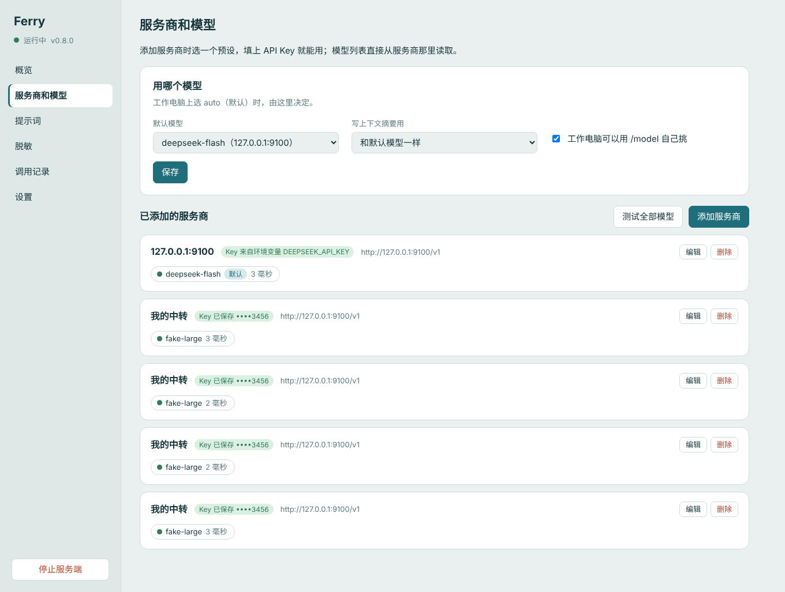

# 服务端：放在哪、接哪家模型、怎么管

Ferry 服务端负责"问模型"这一步：拼回完整对话、加团队提示词、选模型、保管 API Key。这份文档给运行服务端的人看。只在一台电脑上自己用的话，按 [README 的单机安装](../README.md#单机5-分钟) 来就行，服务端由 ferry 自动启动，不用读这里。

## 放在哪

| 你的情况 | 服务端放在 | 步骤 |
|---|---|---|
| 公司电脑受限，家里有一台 Windows 电脑 | 家里的 Windows + Cloudflare 域名 | [DEPLOY-WINDOWS.md](DEPLOY-WINDOWS.md)：用安装包装服务端，桌面图标打开管理页，填 API Key，Cloudflare Tunnel 给它一个域名 |
| 同上，手边是 Mac | Mac + Cloudflare 域名 | [DEPLOY-MAC.md](DEPLOY-MAC.md)：`pipx install`，开机自启脚本，Cloudflare Tunnel |
| 要一直在线，或要用 Claude / OpenAI | Linux 云服务器 + HTTPS | [DEPLOY-LINUX.md](DEPLOY-LINUX.md)：`pipx install`，systemd，Caddy 自动 HTTPS |

Anthropic 和 OpenAI 的 API 不对中国大陆和香港提供服务。要用这两家，服务端得放在它们支持的地区，比如海外的云服务器。

装好后，在服务端管理页"概览"里复制登录命令，贴到工作电脑的新 cmd 窗口里运行，再 `ferry doctor` 检查一遍。

## 管理页

只能在服务端那台电脑上打开：Windows 上双击桌面的 Ferry Server，或者运行 `ferry-server --ui`。

| 页面 | 能做什么 |
|---|---|
| 概览 | 工作电脑用的登录命令（带令牌，一键复制）、流量图、最近的调用 |
| 服务商和模型 | 选预设（DeepSeek、Kimi、智谱、通义、火山、硅基流动、各家编程套餐、Claude、OpenAI、OpenRouter、本机 Ollama、自定义），只填 API Key；读出服务商的模型列表，勾选要用的；选默认模型、写摘要用的模型、生成图片用的模型、顾问模型；每个模型的上下文、最大输出和价格；测试按钮 |
| 提示词 | 所有工作电脑都会带上的团队提示词，可以按项目写 |
| 调用记录 | 每次调用的项目、模型、大小、token、耗时，可以点开看详情 |
| 用量和费用 | 按天、项目、模型汇总，能看到每个模型的缓存命中 |
| 设备和记忆 | 给每台电脑一个令牌；全局记忆（所有电脑共用） |
| 设置 | 外网地址、服务端存不存对话、请求上限、并发、手机通知（Bark）、问题报告（GitHub）、开机启动、换令牌 |

API Key 存在服务端的 `secrets.toml` 里，任何接口都只显示最后 4 位。

**好几台电脑要登录**：在"设备和记忆"里给每台电脑添加一个设备，各拿自己的令牌和登录命令（令牌只显示一次）。某台丢了或不用了，点"作废"，只有它连不上。

## 用哪家模型

在管理页里选，工作电脑不用管。工作电脑上只看到一个 `auto`，由服务端把干活的请求发给默认模型、把写摘要的请求发给摘要模型。管理页里允许的话，工作电脑也能用 `/model` 自己挑：这时列出的是服务端配置的模型，默认模型排第一，不再有 `auto`。

- **Claude**（Opus 5.5 / Sonnet 5.5 / Haiku 5.5）走 Anthropic 自己的接口，带提示词缓存。Opus 5.5 缓存命中的价格是正常输入的 1/20。
- **GPT**（gpt-6.1-sol 等）走 OpenAI 接口（也支持 Responses 接口），OpenAI 会自动缓存。
- 也可以用 DeepSeek、Kimi、通义、智谱，或者任何 OpenAI 兼容接口。

### 为什么每次调用都有几十上百 k token

模型不记得上一轮。agent 每走一步（读个文件、跑条命令）都要把整段对话重新发一遍，Claude Code、Cursor、Codex 都一样。省钱靠这几件事：

- 提示词缓存：重复的那部分按缓存价算（Claude 是原价的 1/20，GPT、DeepSeek 约 1/10）。缓存命中一直是 0 的模型最贵，"用量和费用"里能看到。
- Claude 走中转：Claude 只缓存请求里标记过的部分。服务端会自动给 OpenAI 兼容中转后面的 Claude 加上标记，中转不认就自动去掉。中转如果也支持 `/v1/messages`，在管理页把它的"接口格式"改成 Anthropic 更好，点"测试"会告诉你支不支持。
- 上下文设小一些（工作电脑上 `/context 200k`），会更早写摘要，每次发的也就少。

### 同一个模型有几家服务商

每家服务商的模型各自列出。工作电脑的 `/model` 和 `ferry --list-models` 里，模型前面是服务商的名字，比如 `kiro/claude-opus-5.5` 和 `kiro-fuli/claude-opus-5-5`。选哪家就只用哪家，名字一样也不会混在一起。下面说的合成组在 `ferry` 下面。工作电脑能用的模型只认服务端给的列表：拿不到列表时 ferry 停下并说明原因，不拿上次存下的列表或 pi 自带的模型凑合。

几家确实是同一个模型（比如 Claude 既走官方又走一个可靠的中转），想轮流用，就编辑这几家，都勾上"和别家的同名模型合成一组"（`models.toml` 里是 `[providers.x]` 下的 `share = true`）。勾了的几家，同名模型只列一次，管理页上标着"⇄ 2 家"：

- 每个会话固定用一家，这样提示词缓存有效。
- 同时有几个会话时，新会话分给当前最闲的那家。
- 一家出错（限流、超载、Key 失效、连不上）就自动换另一家，那家先歇一会儿。

0.31 及以前是反过来的：默认合成一组，勾"单独列出"（`separate = true`）才分开。升级后 `separate` 不再起作用，要合成组的重新勾一下。

### 限流

每个服务商可以设每分钟调用次数和并发上限。遇到 429，按 Retry-After（或设置里的时间）冷却。可以给它设一个回退模型，接口格式不同也行（比如 Claude 限流时改用 GPT），工作电脑会按回退模型的格式重发这一轮；没设回退时，请求在服务端排队等，工作电脑的状态栏会显示。

### 上下文长度

每个模型能装多少，在管理页"服务商和模型"→ 编辑里改（"上下文"和"最大输出"两栏）。预设值：Claude 1M；GPT 400k（gpt-6.1-sol 最多能收约 92 万输入 token，但一次请求超过 27.2 万时输入价翻倍）；deepseek-flash 1M。这是上限，工作电脑上用 `/context` 在上限以内挑一个常用的。

请求比模型的上下文还大时，服务端回 `context_length_exceeded`，工作电脑会先写摘要再重试。摘要由服务端写：模型拒绝时带说明再问一次，再不行换摘要模型或默认模型；太大就分段写。

### 顾问模型

管理页“服务商和模型”里的“顾问模型”，给 agent 的 `advisor` 工具用：它请这个模型看一遍对话，说哪里不对、下一步做什么（用法见 [USAGE.md](USAGE.md#旁问顾问和回顾)）。不选，就用设了价格的模型里最贵的；最贵的正好是默认模型时，顾问不开，工作电脑上也就没有这个工具。选了就一定用选的那个。

同一个接口 `POST /v1/ferry/side` 还回答 `/btw`（用对话当前的模型）和长请求做完后的一句话回顾（用“写摘要用”的模型，没设就用最便宜的）。三种都不带工具，对话从服务端已有的那份拼回来，发给模型的是压缩过的文字记录（工具结果只留开头和结尾，太长就丢掉最早的中间部分）。调用记录里分别标着 `advise`、`btw`、`recap`，费用照常计。

## 服务端设置

大多在管理页里改，存在服务端数据目录的 `server.toml`，立即生效。也可以用环境变量（优先于管理页）：

| 环境变量 | 作用 |
|---|---|
| `FERRY_SERVER_HOME` | 数据放哪，比如 `D:\ferry\server`（令牌、Key、models.toml、日志） |
| `DEEPSEEK_API_KEY` 等 | 用环境变量给 Key，优先于管理页里填的 |
| `FERRY_SESSION_STORE` | 服务端存不存对话：`memory`（默认）/ `disk` / `none` |
| `FERRY_GITHUB_TOKEN` / `FERRY_GITHUB_REPO` | 问题报告用的 GitHub 令牌和仓库（优先于管理页） |
| `FERRY_SEARCH` | 网页搜索：不设就是自动（所有能用的来源一起查），`model:<模型名>` 另加这个模型自带的搜索，`bing` 不用服务端搜索 |
| `FERRY_SEARCH_KEY_<来源>` | 搜索 API 的 Key，比如 `FERRY_SEARCH_KEY_TAVILY`、`FERRY_SEARCH_KEY_BOCHA`（优先于管理页） |
| `FERRY_SEARCH_EXA` | 设成 `off` 不用 Exa 的免费搜索 |

多用户的服务器改用完整配置文件 `ferry-server.toml`，参考 [server/ferry-server.example.toml](../server/ferry-server.example.toml)。模型和服务商写在数据目录的 `models.toml` 里，改了不用重启；只认文字的模型加一行 `vision = false`。

## 网页搜索

搜索引擎给程序看的结果页质量差（实测搜"agent memory open source github"，Bing 前几条是字典里 agent 的释义），所以 agent 的 `web_search` 由服务端去搜。

服务端把一个搜索同时发给所有能用的来源：

- Exa 的免费搜索：不用 Key，不用设置。opencode 没有 Key 时也用它。同时搜得太多会被它限流，这时只少了它这一家的结果。
- DeepSeek 搜索：服务端接了 DeepSeek（模型地址是 api.deepseek.com）就自动加上，用同一个 Key。每千次 0.75 美元，结果带几百字的摘要和日期。
- 填了 Key 的搜索 API：[Tavily](https://app.tavily.com) 是给 AI agent 用的，每月有免费额度；[Brave Search](https://api-dashboard.search.brave.com) 有自己的索引；[博查](https://open.bochaai.com) 中文网页多，搜中文时它的结果排得更靠前。在管理页 → 设置 → 网页搜索的第二行选一家，贴 Key，点"保存 Key"。可以填好几家，都会用上。Key 存在数据目录的 `search-keys.json` 里，管理页不显示。
- 模型自带的搜索（可选），和 Claude Code、Codex 的做法一样：在第一行选"另加某某自带的搜索"。服务端用这个模型的 Key 请它搜，让它给每个结果原样摘一两句话。列表里出现的是能这样搜的模型：走 Claude 官方接口的 Claude，和走 OpenAI Responses 接口的 GPT。每次搜索除了 token 另有费用（Claude 官方是每千次 10 美元），也慢，最多等一分钟。kiro 这类中转多半不支持，选好后点"测试"看看。

几家的结果按排名合并（RRF），同一个网页只留一条。然后服务端同时读排在前面的 3 个网页，从正文里挑出和搜索词最相关的段落，原样摘出来（不改写），放在那条结果下面。网页读不到时（PDF、拒绝访问），用搜索来源自己给的原文。整个结果一般在 3k 到 5k token。主模型据此回答，要细看哪个页面再用 `web_fetch` 读。同样的搜索 10 分钟内直接用缓存，几台电脑共用。

管理页上点"测试"，能看到每一家各搜到几条、哪家出错。第一行选"不用服务端搜索"，就回到工作电脑读 Bing 的结果页。

工作电脑下次启动 ferry 时生效。工作电脑只把搜索词发给服务端（几百字节）。所有来源都出错，或者什么都没搜到时，工作电脑自动改用 Bing（带严格安全搜索），并告诉 agent 原因。遇到 502、503、504 会先重试一次；回复不是 JSON 时，提示里写明是哪一层回的（Cloudflare 带 cf-ray，别的显示网页标题）。搜索成功时，结果后面会注明用了哪几家。每次搜索在调用记录里记一行（`search`），不记搜索词。

搜索质量用 `evals/search_eval.py` 量，见 [evals/README.md](../evals/README.md#搜索评测)。

### 读网页

agent 读公开的网页（`web_fetch`）时，工作电脑只把地址发过来，由服务端去读：

- 服务端接了 DeepSeek 时用 DeepSeek 的读网页 API（返回整理好的 Markdown，不少靠脚本生成的网页也能读，每千次 0.75 美元），否则服务端自己下载、转成文字，只留正文（`<main>` 或 `<article>`），去掉导航、侧栏、页脚、Cookie 提示和评论。GitHub 上的文件页（`/blob/`）直接读文件本身。15 分钟内读过的不再重读，搜索时读过的也算。
- agent 带着问题读时（和 Claude Code 的 WebFetch 一样），服务端让"写摘要用"的模型（没设就用默认模型）按问题读，只把回答交回去；不带问题时分段交回网页文字。调用记录里标着 `read` 和 `extract`。
- 服务端不读私有网络上的地址（包括跳转过去的），这样碰不到你家里或公司的内网；工作电脑也不会把内网地址发过来。这些、服务端读不到的网页、PDF 和 Office 文件，由工作电脑自己读或下载。
- 读网页只是从一页里找出和问题有关的内容，用便宜的模型就够；想更准就把"写摘要用"设成好一点的模型。

## 问题报告

工作电脑上的 `/report`（见[使用手册](USAGE.md#报告问题)）把问题报告发到服务端，由服务端在 GitHub 上开 issue。工作电脑只和服务端说话，所以公司电脑上不了 GitHub 也能报。

设置一次就行：

1. 在 GitHub 上建一个 fine-grained personal access token：Settings → Developer settings → Fine-grained tokens，Repository access 只选 `wvans123/ferry`，Permissions 里只给 Issues 读写。
2. 管理页 → 设置 → 问题报告，填仓库（默认 `wvans123/ferry`）和这个令牌，保存。令牌存在数据目录的 `github-token` 文件里，管理页不再显示它。

发出前，服务端会隐去这些内容：问题报告卡片里列的词（公司名、产品名、项目代号、主机名，一行一个）、内网 IP、邮箱、手机号、Key、路径里的用户名（`C:\Users\<user>\...`）。每份报告都存在数据目录的 `data/reports/` 里。管理页只列出没发出去的（写着原因，可以再发一次）；已经发到 GitHub 的只显示一共几份，和一个到 GitHub 上看的链接。

公开仓库的 issue 谁都能看。不想公开，就建一个私有仓库专门收报告，把仓库名填成它。

